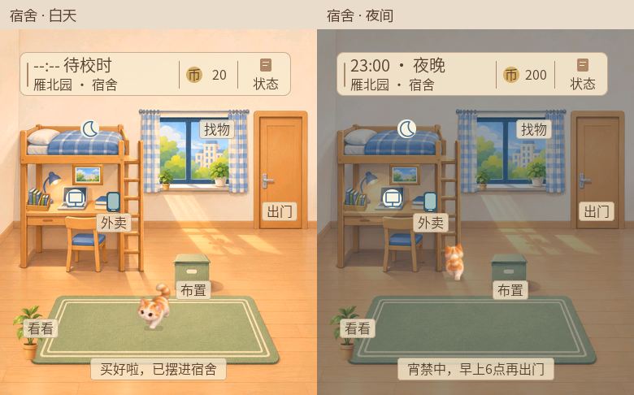

# 沙河校园小猫

一款运行在黄山派上的触屏校园电子宠物。带小猫沿校园道路逛宿舍、教室和食堂，给它点餐、布置房间，或在宿舍玩小游戏赚金币。手表按北京时间切换昼夜和作息，23:00 至次日 06:00 进入宿舍宵禁。

**当前源码 v0.18.0 · 安卓校时工具 v0.1.0**



*固件在电脑上的画面预览。*

| 我想做什么 | 从哪里开始 |
| --- | --- |
| 第一次在电脑上配置项目 | [从零开始配置本地环境](docs/local-setup.md) |
| 烧录后怎么玩、怎么连手机 | [上手与手机校时](docs/pet-quickstart.md) |
| 点餐、外卖、签到、摆家具 | [校园生活与菜品](docs/pet-v017-life.md) |
| 已有功能、未闭环项与同类产品调研 | [功能盘点与市场调研](docs/pet-feature-audit.md) |
| 拿到板子后照着做 | [v0.18.0 真机验收单](docs/pet-v0180-acceptance.md) |
| 打包安卓 APK | [安卓校时工具](android-clock/README.md) |
| 查看需求、架构和验证记录 | [需求](docs/01-需求规格说明.md) · [设计](docs/02-方案设计说明.md) · [测试报告](docs/04-测试报告.md) |

固件基于 SiFli SDK v2.5.1、RT-Thread 和 LVGL v9，目标板型为 `sf32lb52-lchspi-ulp`。固件源码在 [`src/`](src/)，板级工程在 [`project/`](project/)，安卓工具在 [`android-clock/`](android-clock/)。

v0.19.0 按沙河示意图更新校园：建筑名/7 处黄条施工区、学生活动中心弹窗（先中心再健身房/跳舞/羽毛球）、餐厅四窗口、教综楼勤工俭学；目标固件 `main.bin` 4,555,428 字节，ROM 4,629,705/8,388,608，主机逻辑/存档 118 项 PASS，已烧录并启动 v0.19.0（71 项自检 PASS）。**真实屏幕画面/触摸与手机仍待验证**。iPhone 自动校时在 v0.14.2 有用户实测记录，安卓联调仍待 TC-268。

<details>
<summary>课程脚手架与训练参考</summary>

本项目从黄山派课程脚手架开始，以下保留入门训练和课程开发流程。脚手架内置以下内容。

- **AI 软件工程过程文档模板**：计划、需求规格(PRD)、方案设计、测试计划、测试报告、风险台账、架构决策(ADR)、开发日志（Markdown），研制总结（Word）
- **AI agent 驱动开发支持**：`CLAUDE.md` / `AGENTS.md`、Claude Code 斜杠命令、协作指南与提示词
- **git 全程管理**：提交规范由钩子强制，开发日志与提交自动核对
- **入门训练**：T0 环境与规范、T1 用一个小功能完整走一遍“需求 → 设计 → 实现 → 测试 → 总结”
- **开箱即用的 SiFli SDK 工程**（`project/` + `src/`，结构与官方例程一致）：黄山派例程（串口打印 Hello world + 板载 RGB 灯红绿蓝闪烁），装好 SDK v2.5.1 后一条命令编译

个人启动文字修改练习可按[第三周实验步骤](docs/guides/week03-personal-practice.md)执行，步骤区分已有代码/编译结果与尚待用户完成的实物验证。

2026-10-22补齐屏幕练习：当前应用目标v0.1.2，新增LVGL v9静态启动页，项目名、版本和练习文字与串口对应；RGB用定时器驱动，避免阻塞界面和颜色日志刷屏。原始v0.1.0脚手架及已实测v0.1.1仍保留Git历史，旧串口证据不能代替v0.1.2屏幕实测，结果以docs/04-测试报告.md为准。

本次个人练习已完成用户屏幕照片、启动日志、RGB/复位确认和本人解释；[收尾记录](docs/week03-personal-practice-summary.md)集中列出改动、证据、复现方式及限制。完整T0/T1与正式产品仍按各自范围登记。

## 5 分钟上手

```bash
# 1. 前置：Git 2.30+、Python 3.8+、一个 AI agent 工具（Claude Code / Codex 等）
#    以及 SiFli SDK v2.5.1 开发环境（SDK + 工具链，安装步骤见 training/T0）
git config --global user.name  "你的姓名"
git config --global user.email "你的邮箱"

# 2. 进入本目录，安装依赖并初始化（创建仓库、启用钩子、做规范的首次提交）
pip install -r requirements.txt
python scripts/setup_course.py

# 3. 检查开发环境，编译内置例程（在已运行 SDK export 脚本的终端里）
python scripts/check_env.py
python scripts/build_firmware.py

# 4. 看初始状态，然后按 training/T0 开始
python scripts/check_all.py
```

## 目录结构

```
course_starter/
├── README.md                    本文件
├── CLAUDE.md / AGENTS.md        给 AI agent 的项目规范（内容一致，勿删勿改）
├── course.config.json           检查阈值（教师维护）
├── manifest.yaml                提交给教师评审 agent 的交接清单
├── .gitmessage                  提交信息模板
├── .githooks/                   commit-msg（强制规范）、pre-commit（日志提醒）、pre-push
├── .claude/commands/            Claude Code 斜杠命令：/commit /devlog /doc-sync /milestone-check /physical-verify
├── .github/workflows/           CI：push 时自动运行 check_all.py
├── docs/
│   ├── 00-项目计划与里程碑.md
│   ├── 01-需求规格说明.md        PRD，REQ-xxx 编号
│   ├── 02-方案设计说明.md
│   ├── 03-测试计划.md            TC-xxx 编号
│   ├── 04-测试报告.md
│   ├── 05-研制总结.docx          Word，M5 阶段填写
│   ├── 06-风险与问题台账.md
│   ├── adr/                     架构决策记录
│   ├── devlog/                  开发日志（每个开发日一篇）
│   └── guides/                  git 规范 / 日志规范 / agent 协作指南
├── training/                    入门训练 T0、T1 + 进度登记
├── project/                     SiFli SDK 工程目录：SConstruct、SConscript、Kconfig*、proj.conf、rtconfig.py
├── src/                         应用源码：main.c（Hello + RGB 闪烁）；新增 .c 自动参与编译
├── evidence/                    物理验证原始证据
├── logs/                        agent 会话记录
└── scripts/                     检查与辅助脚本
```

## 日常工作流（每次开发会话）

```
开工汇报 → 计划(你确认) → 文档先行 → 测试 → 实现 → 验证 → 小步提交 → 收工(日志 + 检查)
```

| 时点 | 做什么 | 命令 |
|---|---|---|
| 开工 | 让 agent 汇报当前状态 | 提示词见 `docs/guides/agent-collaboration.md` §6.1 |
| 开发中 | 每完成一小块就提交 | `git commit`（模板自动弹出）或 `/commit` |
| 需要真机 | agent 暂停，你操作并留证据 | `/physical-verify <事项>`，证据入 `evidence/` |
| 收工 | 写日志并自检 | `/devlog`，`python scripts/check_all.py` |
| 里程碑前 | 严格检查、打标签 | `python scripts/check_all.py --final`，`git tag -a M2-... ` |

## 提交信息速查

```
<type>(<scope>): <主题>

背景: 为什么改
改动: 改了什么
验证: 怎么验证的
AI协作: 否 | 是(工具/模型；采纳了什么；人工修正了什么)
```

type：`feat fix docs test refactor perf build ci chore revert hw`。`feat/fix/refactor/perf/test/hw` 四项全填，其他类型至少填“改动”与“AI协作”。详见 `docs/guides/git-workflow.md`。

## 检查脚本一览

| 命令 | 作用 |
|---|---|
| `python scripts/check_all.py [--final]` | 一键检查（提交规范 / 开发日志 / 需求追踪 / manifest；`--final` 加固件编译） |
| `python scripts/check_commit_msg.py --log` | 校验历史中所有提交信息 |
| `python scripts/new_devlog.py [--update]` | 创建/刷新今天的开发日志 |
| `python scripts/check_devlog.py [--json]` | 日志缺失、简略、断档检查 |
| `python scripts/check_trace.py [--final]` | REQ 在 PRD/设计/测试计划/测试报告间的追踪 |
| `python scripts/check_env.py` | 检查 SiFli SDK、scons、ARM 编译器等开发环境 |
| `python scripts/build_firmware.py` | 编译固件（在 project/ 下调用 scons），并提示下载命令 |
| `python scripts/check_manifest.py` | manifest 完整性与证据文件存在性 |

> 脚本通过只代表“字段齐全、规则满足”，**不代表内容质量合格**。评审时教师（及评审 agent）会核对日志、提交、证据三者是否互相印证。

## 重要提醒

1. **不要用 `git commit --no-verify`**，也不要删改 `.githooks/`、`scripts/check_*.py`、`course.config.json`、`CLAUDE.md`/`AGENTS.md`——这些改动会出现在历史里。
2. agent 写的文档/代码/日志，**你必须读过、验证过**再提交；`AI协作:` 里写的“人工修正”必须是真的。
3. 没有条件做的物理验证，如实写进 `known_issues`；编造证据按学术诚信处理。
4. 密钥、令牌、隐私信息不要进仓库，也不要出现在 `logs/` 里。
5. `src/` 下只有 `main.c` 含 `main()`；新增模块不要再定义 `main`。`project/` 下的 `SConstruct`、`Kconfig`、`rtconfig.py` 是 SDK 骨架，不要随意改。
6. 编译产物在 `project/` 下生成（`build_*/`、`sifli_sdk/`、`src/`，已在 .gitignore），不要提交。

## 常见问题

**Q：初始状态为什么有 FAIL？** 开发日志的 FAIL 来自还没写日志；manifest 的警告来自模板未填写，都是预期的，按训练逐个处理。

**Q：不在 GitHub 上，能用 Gitee 吗？** 可以。所有检查都是本地 Python 脚本，CI 可用任意平台的流水线执行 `python scripts/check_all.py`。

**Q：我的 agent 工具读不到 CLAUDE.md/AGENTS.md？** 把 `AGENTS.md` 全文粘贴到会话开头，并在 `manifest.yaml` 里如实填写 `dev_agent.tool`。

**Q：Windows 下钩子不生效？** 使用 Git for Windows，确认 `git config core.hooksPath` 为 `.githooks`；仍有问题时运行 `python scripts/check_commit_msg.py --log` 手动自查，并告知教师。

</details>


