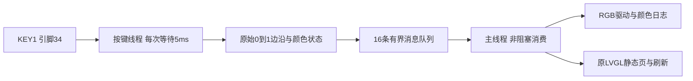
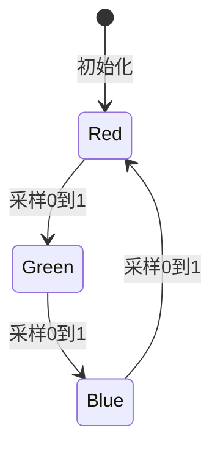
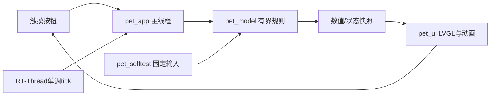
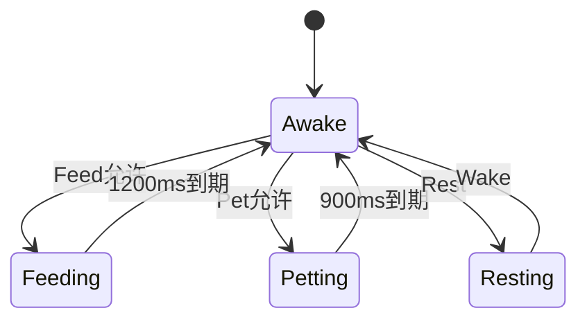

# 方案设计说明：第三周个人修改练习

创建日期：2026-10-16；更新日期：2026-10-22。需求来源：01-需求规格说明.md。第1—3节保留REQ-001/v0.1.1设计；第4节是新增REQ-002/v0.1.2计划。

## 1. 运行路径

RT-Thread 调用 src/main.c 的 main() → 输出应用名和版本 → 输出练习文字 → 调用已有 RGB 初始化与循环。

| 模块 | 设计 | 需求 | 代码 | 测试 |
|---|---|---|---|---|
| 启动标识 | APP_VERSION 从 0.1.0 改成 0.1.1；将 Hello world! 替换为固定英文练习文字。继续使用原有 rt_kprintf，不新增线程、状态机或纯逻辑模块 | REQ-001 | src/main.c | TC-001、TC-002 |

## 2. 接口与资源

使用现有 rt_kprintf(const char *, ...) 串口输出；字符串位于启动路径、while 循环之前，每次启动执行一次。不改工程构建脚本、SDK 配置或引脚。

原有 RGB 红、绿、蓝循环可用于观察程序继续运行。串口日志只说明代码执行到打印处，不能证明 RGB 灯的实际颜色；本练习不新增 RGB 实测结论。

## 3. 验证与边界

- 主机：运行 scripts/build_firmware.py，保存完整输出并确认返回码和 `scons: done building targets.`。
- 硬件：按生成的 uart_download.bat 下载 bootloader、main、ftab；用户在 1000000 baud 串口监视器复位并保存原始日志。
- REQ-001 首次启动由 TC-001 验证，再次复位由 TC-002 验证。
- 不增加架构或硬件选型决策；正式产品方向留待用户后续确定。

## 4. REQ-002：补齐屏幕启动文字

用户连续指出文字应在屏幕显示、屏幕不亮，继续原个人练习，按此前提出的最小屏幕页补齐。复用课程既定LVGL v9和本机SDK已有显示适配，不涉及产品方向或硬件选型；只参考peripheral_lab初始化方式，不复制整个工程。

运行路径：main输出v0.1.2与练习文字 → 查找lcd → littlevgl2rtt_init("lcd") → 创建course_ui页面 → 初始化原RGB并创建500ms定时器 → 主线程循环调用lv_timer_handler，等待限制为2—20ms。RGB的开/关延时改由同一UI线程的LVGL定时器驱动，避免原1秒阻塞妨碍屏幕刷新；去掉重复颜色打印，保留启动和错误日志。

| 模块 | 实现位置与职责 | 需求 | 测试 |
|---|---|---|---|
| LCD与LVGL启动 | src/main.c：检查lcd注册、适配初始化及默认display；错误输出实际返回值，不把返回成功当成屏幕已通过 | REQ-002 | TC-003、TC-004 |
| 静态文字页 | src/course_ui.c/.h：唯一入口由main调用，所有LVGL创建与定时器都在主线程 | REQ-002 | TC-003、TC-004 |
| 配置 | project/proj.conf：启用SDK图形适配和v9，配置实际使用的字体与主线程栈 | REQ-002 | 完整构建、TC-003 |

配置依据：SDK example/multimedia/lvgl/lvgl_v9_demos及middleware/lvgl的Kconfig/适配代码。PKG_USING_LITTLEVGL2RTT接入板级lcd驱动；LVGL_V9选课程版本；RT_MAIN_THREAD_STACK_SIZE=8192沿用SDK界面示例，避免原2048字节栈承担绘图；Montserrat 20/24/28分别用于项目名/正文/版本，默认16。使用SDK默认单份100行局部绘图缓冲，不额外叠加整屏像素缓存；不改SConstruct、SConscript或SDK源码。

首次构建显示SDK的app_mem.c需要完整rt_memheap结构与rt_memheap_alloc等接口；启用RT_USING_MEMHEAP，与上述SDK官方示例一致。它为图形适配提供所需内存堆API，不是扩大缓冲或屏蔽编译错误。首次失败日志保留后再构建。

视觉按frontend-design技能规划：390×450竖屏，左边距40像素。白蓝底#F4F8FE、深蓝字#16324F、辅助字#4B6581、蓝色短线#2866BD。项目名20号、版本28号、正文24号，固定英文自动换行；短蓝线标记启动文字区。使用SDK内置字体，无需下载字体或图片。页面只表达正在运行的固件，不显示“测试通过”。

接口：course_ui_create(app_name, version, message)，版本和文字由main传入，与串口使用同一数据。保留原RGB引脚与颜色顺序；不接入网络、传感器或触摸业务。既有v0.1.1证据仍原样保留，新版有独立固件校验和实物用例。

## 5. T1需求与模块约定（代码修改前）

REQ-003、REQ-004：KEY1采样产生按下事件，颜色状态按红/绿/蓝循环，RGB输出及串口由主线程消费事件；屏幕继续由原主线程刷新。用户已选择周期轮询，名义周期5ms。完整取舍、状态与错误路径见本次后续ADR及第6节。TC-005检验顺序，TC-006检验一按一次；TC-007为构建检查，TC-008为板上逻辑自检，均不能代替实物用例。

## 6. T1详细设计（REQ-003、REQ-004）

### 6.1 方案选择与接口依据

ADR-0001选择周期轮询，决策人王焕博，原话为“周期轮询（推荐）：约每5ms读一次按键，便于理解和调试”，见evidence/T1/polling_choice_20261022_user.txt。备选为GPIO中断；两者首版均不加消抖。

已核对SDK v2.5.1：board.conf与现有rtconfig.h均定义BSP_KEY1_PIN=34、BSP_KEY1_ACTIVE_HIGH=1；rtos/rtthread/components/drivers/include/drivers/pin.h声明rt_pin_read，rtos/rtthread/include/rtthread.h声明rt_thread_create/startup/delete、rt_mq_create/send/recv/delete。现有配置已启用GPIO、消息队列、1000Hz tick；无需改proj.conf或构建脚本。

KEY1复用电源/下载功能，沿用BSP现有输入与上下拉，只读取，不重新配置GPIO或注册中断。参考peripheral_lab/src/modules/test_key.c的只读KEY1处理方式，但不复制其消抖。

### 6.2 职责、线程与数据

| 模块 | 实现 | 职责 | 所有权 |
|---|---|---|---|
| 原始边沿/颜色状态 | src/key.c | 保存上次电平和颜色索引；只有0→1产生事件，颜色索引0/1/2循环；启动时用实际电平初始化 | 仅按键线程拥有 |
| 轮询线程 | src/key.c | 每次采样后rt_thread_mdelay(5)，事件非阻塞入队；不操作RGB或LVGL | 1024字节栈、优先级9、时间片10 tick；5ms为请求等待，非实测保证 |
| 消息队列 | src/key.c/.h | 最多16条事件，事件包含press_count和color_index两个32位值；main非阻塞读取 | 队列传递值，不共享可写颜色状态 |
| RGB/串口与界面 | src/main.c | 初始红灯；按事件设置颜色，驱动返回成功后打印press计数/颜色；每轮最多消费16条后刷新原LVGL页 | 主线程，所有RGB与LVGL调用在此 |

消息接口：t1_key_start()启动一次；t1_key_receive(event)零等待取一条；t1_key_self_test()执行固定输入的板上自检。正常运行资源与应用同寿命。队列/线程创建或启动失败时清理已创建资源并返回错误；采样非法或队列发送失败时打印错误并停止按键线程，用户可重启恢复，不把丢失输入当成通过。RGB命令失败打印实际错误，不打印该次切换成功日志。

### 6.3 状态与初始化

启动色为红；启动已经按下时不会生成虚假按下事件，先释放后再次按下才切色。保持同一电平、从1→0释放均不切色。只有采样到0→1才切下一色并增加计数。第一版原始抖动0/1/0/1会产生两条边沿，此为明确风险；是否在真实按键出现必须等实物证据。

其他采样状态保持当前颜色。硬件颜色依据真实观察，rt_device_control返回成功只说明驱动接受命令。

### 6.4 验证与失败恢复

TC-008在启动时检查固定输入的颜色循环、按住不重复、释放不切换、启动已按下不误触发，以及原始抖动产生重复边沿的已知行为。源码中有PASS字符串或编译成功均不代表板上自检已运行。TC-005检查10次顺序；TC-006检查20次与后续30次计数；TC-007检查完整构建。实物验证由学生完成，收到证据前不追加虚构physical_verification或设置pass=true。

按键出错打印错误；复位重新创建状态/队列后可重试。首版不做触摸、联网、长按识别、持久化或自动切色。若真实测试出现多次切换，先更新设计/风险再实现消抖，保留首版失败与后续回归。

| 需求 | 模块/接口 | 验证 |
|---|---|---|
| REQ-003 | 颜色状态、消息队列、main RGB输出 | TC-005、TC-007、TC-008 |
| REQ-004 | 原始按下边沿；首版不消抖，风险公开 | TC-006、TC-007、TC-008；最终依物理TC-006 |

## 7. 正式产品选题（2026-10-23，仅方向确定）

用户已确认两人团队并选择电子宠物，原话见evidence/pet/product_direction_20261023_user.txt。此决定不改变前面已验证训练设计。

| 决策 | 备选与权衡 | 决定及依据 | ADR |
|---|---|---|---|
| 产品方向 | 体感迷宫重在校准/碰撞；电子宠物重在照料/时间/动画；桌面状态牌重在配套端/通信 | 用户明确选择电子宠物：喂食互动、状态变化、动画反馈；未提供个人选择理由，不代编 | adr/0002-pet-product-direction.md |

首版功能、视觉、存储/联网、线程边界与实际分工尚未确定，见pet-inception-draft.md。后续确认后再补正式需求与测试追踪、具体架构ADR；本轮无产品实现或实物结果。

## 8. 电子宠物v0.3.0架构（REQ-110、REQ-111、REQ-112、REQ-113、REQ-114、REQ-115）

采用ADR-0003默认方案：主线程独占模型、输入与LVGL；短小规则有界执行，不新增工作线程。对比独立业务线程+消息队列，当前无耗时I/O，单线程减少共享状态和对象生命周期风险。用户已授权列出后直接实施，具体选择由AI提出。将来存储/联网需另核对阻塞与线程边界。

| 模块 | 职责 | 关联需求 | 验证 |
|---|---|---|---|
| src/pet_model.c/.h | 纯C规则；按经过毫秒推进，64位中间量累计，整除补算，饱和加减；事件只结算一次 | REQ-111、REQ-112、REQ-113 | TC-111、TC-112、TC-113 |
| src/pet_selftest.c/.h | 相同固定输入测试供主机与板上调用；覆盖边界、连点、冷却、长间隔、休息和32位tick回绕 | REQ-111、REQ-112、REQ-113、REQ-115 | TC-111、TC-117 |
| src/pet_ui.c/.h | LVGL对象与动画定时器，回调发操作意图；重建先删除旧定时器，更新模型快照 | REQ-110、REQ-113、REQ-114 | TC-110、TC-113、TC-114、TC-115 |
| src/pet_app.c/.h、main.c | 唯一模型所有者；事件前先推进时钟，主循环继续LVGL；启动自检失败不进入UI | REQ-110、REQ-111、REQ-112、REQ-113、REQ-114、REQ-115 | TC-110～117 |

清醒显示优先级为动作→饥饿→低落→开心/待机。动作期间输入拒绝而非排队，冷却独立倒计时；已满与拒绝不会增加数值。休息时保留先前清醒心情衰减余数，醒后继续；休息累计增益余数在新一次休息时重置。32位无符号tick差处理一次回绕，循环必须在一次完整回绕周期内运行；按RT_TICK_PER_SECOND转换毫秒并保留余数，避免舍入持续丢时间。

视觉遵循frontend-design：cloud #EAF3F8、ink #233B50、lake #2A7A89、mint #80BDA6、sun #FFC96B、muted #667D8B，白色为中性辅助。标题Montserrat28、操作20、正文/数值16，均沿用现有配置。小猫身体、耳朵和尾巴由LVGL基本对象组成，黄色腹部为角色特征；眨眼/轻微浮动/动作反馈集中在角色，数值和按钮保持稳定。只用少量对象，不加载大图或全屏透明帧。主机预览采用实际pet_ui源码与SDK LVGL；只是软件渲染，另需真机核对。

原T1的key.c/course_ui.c与历史证据保留；产品main不启动训练按键线程或RGB轮换，不修改其训练结论。SConscript自动收集新增C源，不改构建脚本、proj.conf或SDK。

## 9. 2026-10-24奶白橘猫视觉修正（REQ-110、REQ-113、REQ-114）

根据用户选择重绘角色。fur #FFF8E9、orange #EAB179、outline #674B3E、blush #E6A0A0配合原cloud #EAF3F8与lake #2A7A89；标题Montserrat28、操作20、正文16沿用现有层级。特征为橘色耳斑、圆脸与短爪，柔和棕色描边、小鼻子和卷尾。仅调整角色及附近地面/表情标记位置，数值、按钮和模型不变。

美术源文件是原创可编辑SVG，用scripts/make_cat_assets.cjs导出PNG和LVGL RGB565A8常量。身体196×160，加88×44局部五官的5种表情和30×28爱心，共154680字节图像数据；静态图在ROM，按已有100ms定时器切换局部表情，避免逐帧分配或索引解码整图。没有新库进入固件；不改SDK、proj.conf或构建骨架。实际板端解码、内存和表现需物理验证，主机不替代。
