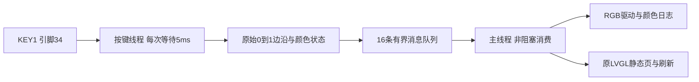
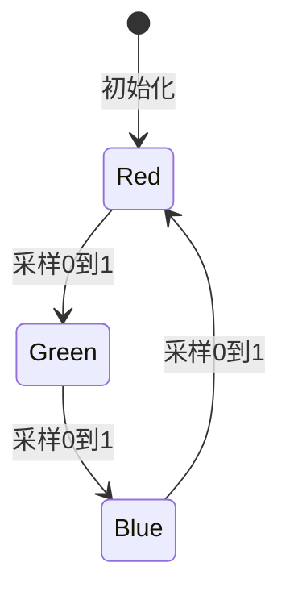
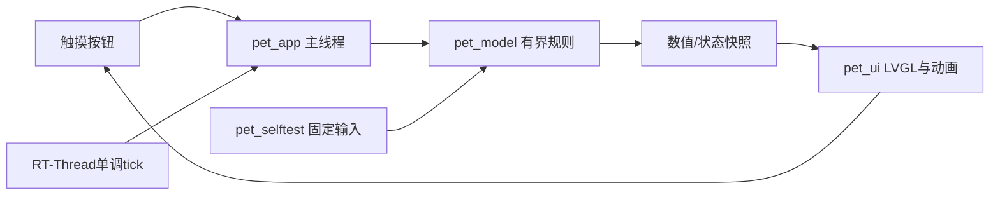
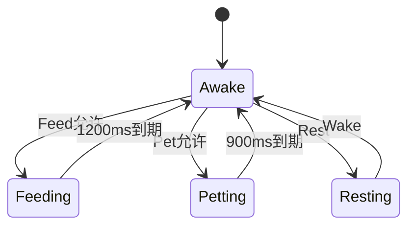
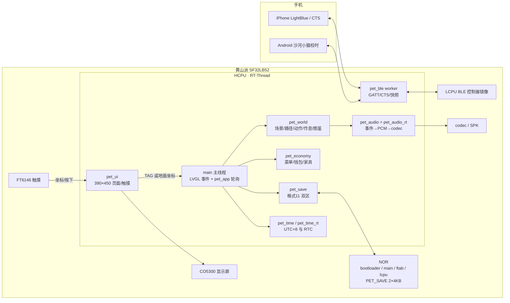
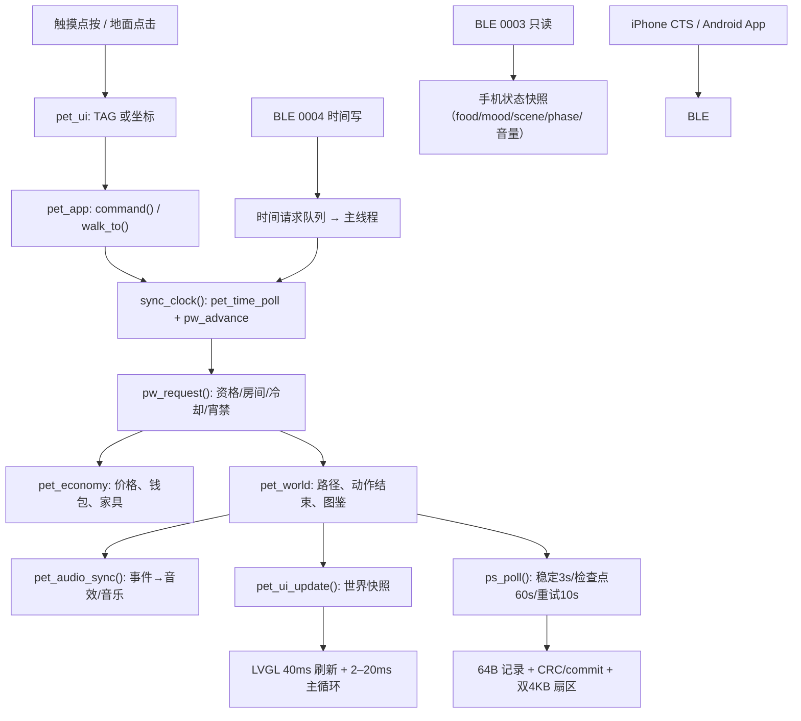
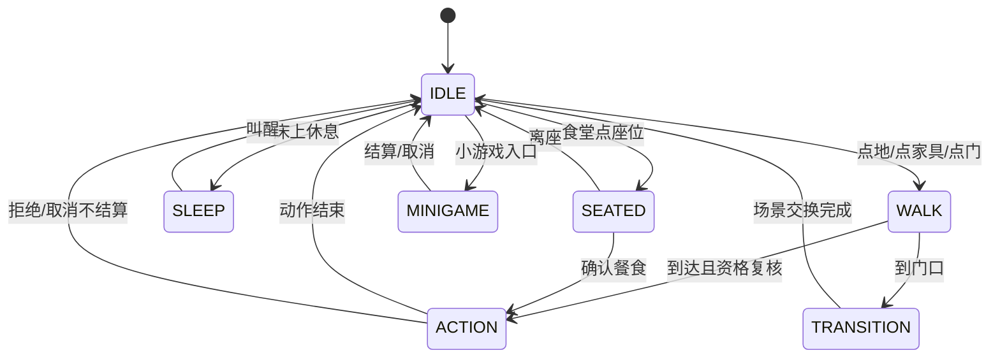

# 方案设计说明：沙河校园小猫（含个人练习与 T1 历史）

创建日期：2026-10-16；更新日期：2026-11-10。需求来源：01-需求规格说明.md。第 1—7 节保留 REQ-001/002 与 T1 设计，第 8 节起为电子宠物产品设计；当前源码 v0.18.0，最新图鉴与存档格式 11 见文末。

> **当前设计入口**：第 12 节“v0.18.0 当前产品设计总览”给出系统架构、数据流、状态机、模块接口、存档字节布局、390×450 界面分区和并发/资源边界；前面章节是历史版本取舍，不替代该总览。

## 1. 运行路径

RT-Thread 调用 src/main.c 的 main() → 输出应用名和版本 → 输出练习文字 → 调用已有 RGB 初始化与循环。

| 模块 | 设计 | 需求 | 代码 | 测试 |
|---|---|---|---|---|
| 启动标识 | APP_VERSION 从 0.1.0 改成 0.1.1；将 Hello world! 替换为固定英文练习文字。继续使用原有 rt_kprintf，不新增线程、状态机或纯逻辑模块 | REQ-001 | src/main.c | TC-001、TC-002 |

## 2. 接口与资源

使用现有 rt_kprintf(const char *, ...) 串口输出；字符串位于启动路径、while 循环之前，每次启动执行一次。不改工程构建脚本、SDK 配置或引脚。

原有 RGB 红、绿、蓝循环可用于观察程序继续运行。串口日志只说明代码执行到打印处，不能证明 RGB 灯的实际颜色；本练习不新增 RGB 实测结论。

## 3. 验证与边界

- 主机：运行 scripts/build_firmware.py，保存完整输出并确认返回码和 `scons: done building targets.`。
- 硬件：按生成的 uart_download.bat 下载 bootloader、main、ftab；用户在 1000000 baud 串口监视器复位并保存原始日志。
- REQ-001 首次启动由 TC-001 验证，再次复位由 TC-002 验证。
- 不增加架构或硬件选型决策；正式产品方向留待用户后续确定。

## 4. REQ-002：补齐屏幕启动文字

用户连续指出文字应在屏幕显示、屏幕不亮，继续原个人练习，按此前提出的最小屏幕页补齐。复用课程既定LVGL v9和本机SDK已有显示适配，不涉及产品方向或硬件选型；只参考peripheral_lab初始化方式，不复制整个工程。

运行路径：main输出v0.1.2与练习文字 → 查找lcd → littlevgl2rtt_init("lcd") → 创建course_ui页面 → 初始化原RGB并创建500ms定时器 → 主线程循环调用lv_timer_handler，等待限制为2—20ms。RGB的开/关延时改由同一UI线程的LVGL定时器驱动，避免原1秒阻塞妨碍屏幕刷新；去掉重复颜色打印，保留启动和错误日志。

| 模块 | 实现位置与职责 | 需求 | 测试 |
|---|---|---|---|
| LCD与LVGL启动 | src/main.c：检查lcd注册、适配初始化及默认display；错误输出实际返回值，不把返回成功当成屏幕已通过 | REQ-002 | TC-003、TC-004 |
| 静态文字页 | src/course_ui.c/.h：唯一入口由main调用，所有LVGL创建与定时器都在主线程 | REQ-002 | TC-003、TC-004 |
| 配置 | project/proj.conf：启用SDK图形适配和v9，配置实际使用的字体与主线程栈 | REQ-002 | 完整构建、TC-003 |

配置依据：SDK example/multimedia/lvgl/lvgl_v9_demos及middleware/lvgl的Kconfig/适配代码。PKG_USING_LITTLEVGL2RTT接入板级lcd驱动；LVGL_V9选课程版本；RT_MAIN_THREAD_STACK_SIZE=8192沿用SDK界面示例，避免原2048字节栈承担绘图；Montserrat 20/24/28分别用于项目名/正文/版本，默认16。使用SDK默认单份100行局部绘图缓冲，不额外叠加整屏像素缓存；不改SConstruct、SConscript或SDK源码。

首次构建显示SDK的app_mem.c需要完整rt_memheap结构与rt_memheap_alloc等接口；启用RT_USING_MEMHEAP，与上述SDK官方示例一致。它为图形适配提供所需内存堆API，不是扩大缓冲或屏蔽编译错误。首次失败日志保留后再构建。

视觉按frontend-design技能规划：390×450竖屏，左边距40像素。白蓝底#F4F8FE、深蓝字#16324F、辅助字#4B6581、蓝色短线#2866BD。项目名20号、版本28号、正文24号，固定英文自动换行；短蓝线标记启动文字区。使用SDK内置字体，无需下载字体或图片。页面只表达正在运行的固件，不显示“测试通过”。

接口：course_ui_create(app_name, version, message)，版本和文字由main传入，与串口使用同一数据。保留原RGB引脚与颜色顺序；不接入网络、传感器或触摸业务。既有v0.1.1证据仍原样保留，新版有独立固件校验和实物用例。

## 5. T1需求与模块约定（代码修改前）

REQ-003、REQ-004：KEY1采样产生按下事件，颜色状态按红/绿/蓝循环，RGB输出及串口由主线程消费事件；屏幕继续由原主线程刷新。用户已选择周期轮询，名义周期5ms。完整取舍、状态与错误路径见本次后续ADR及第6节。TC-005检验顺序，TC-006检验一按一次；TC-007为构建检查，TC-008为板上逻辑自检，均不能代替实物用例。

## 6. T1详细设计（REQ-003、REQ-004）

### 6.1 方案选择与接口依据

ADR-0001选择周期轮询，决策人王焕博，原话为“周期轮询（推荐）：约每5ms读一次按键，便于理解和调试”，见evidence/T1/polling_choice_20261022_user.txt。备选为GPIO中断；两者首版均不加消抖。

已核对SDK v2.5.1：board.conf与现有rtconfig.h均定义BSP_KEY1_PIN=34、BSP_KEY1_ACTIVE_HIGH=1；rtos/rtthread/components/drivers/include/drivers/pin.h声明rt_pin_read，rtos/rtthread/include/rtthread.h声明rt_thread_create/startup/delete、rt_mq_create/send/recv/delete。现有配置已启用GPIO、消息队列、1000Hz tick；无需改proj.conf或构建脚本。

KEY1复用电源/下载功能，沿用BSP现有输入与上下拉，只读取，不重新配置GPIO或注册中断。参考peripheral_lab/src/modules/test_key.c的只读KEY1处理方式，但不复制其消抖。

### 6.2 职责、线程与数据

| 模块 | 实现 | 职责 | 所有权 |
|---|---|---|---|
| 原始边沿/颜色状态 | src/key.c | 保存上次电平和颜色索引；只有0→1产生事件，颜色索引0/1/2循环；启动时用实际电平初始化 | 仅按键线程拥有 |
| 轮询线程 | src/key.c | 每次采样后rt_thread_mdelay(5)，事件非阻塞入队；不操作RGB或LVGL | 1024字节栈、优先级9、时间片10 tick；5ms为请求等待，非实测保证 |
| 消息队列 | src/key.c/.h | 最多16条事件，事件包含press_count和color_index两个32位值；main非阻塞读取 | 队列传递值，不共享可写颜色状态 |
| RGB/串口与界面 | src/main.c | 初始红灯；按事件设置颜色，驱动返回成功后打印press计数/颜色；每轮最多消费16条后刷新原LVGL页 | 主线程，所有RGB与LVGL调用在此 |

消息接口：t1_key_start()启动一次；t1_key_receive(event)零等待取一条；t1_key_self_test()执行固定输入的板上自检。正常运行资源与应用同寿命。队列/线程创建或启动失败时清理已创建资源并返回错误；采样非法或队列发送失败时打印错误并停止按键线程，用户可重启恢复，不把丢失输入当成通过。RGB命令失败打印实际错误，不打印该次切换成功日志。

### 6.3 状态与初始化

启动色为红；启动已经按下时不会生成虚假按下事件，先释放后再次按下才切色。保持同一电平、从1→0释放均不切色。只有采样到0→1才切下一色并增加计数。第一版原始抖动0/1/0/1会产生两条边沿，此为明确风险；是否在真实按键出现必须等实物证据。

其他采样状态保持当前颜色。硬件颜色依据真实观察，rt_device_control返回成功只说明驱动接受命令。

### 6.4 验证与失败恢复

TC-008在启动时检查固定输入的颜色循环、按住不重复、释放不切换、启动已按下不误触发，以及原始抖动产生重复边沿的已知行为。源码中有PASS字符串或编译成功均不代表板上自检已运行。TC-005检查10次顺序；TC-006检查20次与后续30次计数；TC-007检查完整构建。实物验证由学生完成，收到证据前不追加虚构physical_verification或设置pass=true。

按键出错打印错误；复位重新创建状态/队列后可重试。首版不做触摸、联网、长按识别、持久化或自动切色。若真实测试出现多次切换，先更新设计/风险再实现消抖，保留首版失败与后续回归。

| 需求 | 模块/接口 | 验证 |
|---|---|---|
| REQ-003 | 颜色状态、消息队列、main RGB输出 | TC-005、TC-007、TC-008 |
| REQ-004 | 原始按下边沿；首版不消抖，风险公开 | TC-006、TC-007、TC-008；最终依物理TC-006 |

## 7. 正式产品选题（2026-10-23，仅方向确定）

用户已确认两人团队并选择电子宠物，原话见evidence/pet/product_direction_20261023_user.txt。此决定不改变前面已验证训练设计。

| 决策 | 备选与权衡 | 决定及依据 | ADR |
|---|---|---|---|
| 产品方向 | 体感迷宫重在校准/碰撞；电子宠物重在照料/时间/动画；桌面状态牌重在配套端/通信 | 用户明确选择电子宠物：喂食互动、状态变化、动画反馈；未提供个人选择理由，不代编 | adr/0002-pet-product-direction.md |

首版功能、视觉、存储/联网、线程边界与实际分工尚未确定，见pet-inception-draft.md。后续确认后再补正式需求与测试追踪、具体架构ADR；本轮无产品实现或实物结果。

## 8. 电子宠物v0.3.0架构（REQ-110、REQ-111、REQ-112、REQ-113、REQ-114、REQ-115）

采用ADR-0003默认方案：主线程独占模型、输入与LVGL；短小规则有界执行，不新增工作线程。对比独立业务线程+消息队列，当前无耗时I/O，单线程减少共享状态和对象生命周期风险。用户已授权列出后直接实施，具体选择由AI提出。将来存储/联网需另核对阻塞与线程边界。

| 模块 | 职责 | 关联需求 | 验证 |
|---|---|---|---|
| src/pet_model.c/.h | 纯C规则；按经过毫秒推进，64位中间量累计，整除补算，饱和加减；事件只结算一次 | REQ-111、REQ-112、REQ-113 | TC-111、TC-112、TC-113 |
| src/pet_selftest.c/.h | 相同固定输入测试供主机与板上调用；覆盖边界、连点、冷却、长间隔、休息和32位tick回绕 | REQ-111、REQ-112、REQ-113、REQ-115 | TC-111、TC-117 |
| src/pet_ui.c/.h | LVGL对象与动画定时器，回调发操作意图；重建先删除旧定时器，更新模型快照 | REQ-110、REQ-113、REQ-114 | TC-110、TC-113、TC-114、TC-115 |
| src/pet_app.c/.h、main.c | 唯一模型所有者；事件前先推进时钟，主循环继续LVGL；启动自检失败不进入UI | REQ-110、REQ-111、REQ-112、REQ-113、REQ-114、REQ-115 | TC-110～117 |

清醒显示优先级为动作→饥饿→低落→开心/待机。动作期间输入拒绝而非排队，冷却独立倒计时；已满与拒绝不会增加数值。休息时保留先前清醒心情衰减余数，醒后继续；休息累计增益余数在新一次休息时重置。32位无符号tick差处理一次回绕，循环必须在一次完整回绕周期内运行；按RT_TICK_PER_SECOND转换毫秒并保留余数，避免舍入持续丢时间。

视觉遵循frontend-design：cloud #EAF3F8、ink #233B50、lake #2A7A89、mint #80BDA6、sun #FFC96B、muted #667D8B，白色为中性辅助。标题Montserrat28、操作20、正文/数值16，均沿用现有配置。小猫身体、耳朵和尾巴由LVGL基本对象组成，黄色腹部为角色特征；眨眼/轻微浮动/动作反馈集中在角色，数值和按钮保持稳定。只用少量对象，不加载大图或全屏透明帧。主机预览采用实际pet_ui源码与SDK LVGL；只是软件渲染，另需真机核对。

原T1的key.c/course_ui.c与历史证据保留；产品main不启动训练按键线程或RGB轮换，不修改其训练结论。SConscript自动收集新增C源，不改构建脚本、proj.conf或SDK。

## 9. 2026-10-24奶白橘猫视觉修正（REQ-110、REQ-113、REQ-114）

根据用户选择重绘角色。fur #FFF8E9、orange #EAB179、outline #674B3E、blush #E6A0A0配合原cloud #EAF3F8与lake #2A7A89；标题Montserrat28、操作20、正文16沿用现有层级。特征为橘色耳斑、圆脸与短爪，柔和棕色描边、小鼻子和卷尾。仅调整角色及附近地面/表情标记位置，数值、按钮和模型不变。

美术源文件是原创可编辑SVG，用scripts/make_cat_assets.cjs导出PNG和LVGL RGB565A8常量。身体196×160，加88×44局部五官的5种表情和30×28爱心，共154680字节图像数据；静态图在ROM，按已有100ms定时器切换局部表情，避免逐帧分配或索引解码整图。没有新库进入固件；不改SDK、proj.conf或构建骨架。实际板端解码、内存和表现需物理验证，主机不替代。

## 10. AI生图猫接入v0.3.2（REQ-110、REQ-113、REQ-114）

沿用已确认奶白橘猫配色和原页面字体/布局，角色改用内置image_gen生成且用户认可的PNG；3次编辑只要求修改眼睛/嘴巴/眉毛，保持毛色、歪头、轮廓与构图。源图和提示词存assets/pet-cat-ai，v0.3.1 SVG保留作历史。

四张统一1254×1254的RGBA源图采用同一透明边缘裁切和等比缩放，导出196×160的RGB565A8常量，待机/闭眼/吃东西/低落整张切换；闭眼复用于眨眼、开心/摸摸及休息，摸摸仍显示原爱心，休息保留z z。四帧与原30×28爱心共378840字节，不新增PNG解码库或修改SDK/配置；转换脚本保留原图/参数以便复现，不再用SVG重绘这只猫。4张整帧以可接受的ROM增量保持原图质感，动画不逐帧分配缓冲；动态堆栈/显示驱动仍待板卡验证。

## 11. 沙河校园v0.4.0（REQ-120、REQ-121、REQ-122、REQ-123）

选择记录见ADR-0004。用户明确选择校园行为版本；沿用主线程独占纯C模型，不新增线程。模型增加scene和上课冷却，出行事件由应用协调处理同一模型；UI只根据快照选择场景图、猫表情和按钮。课堂5秒/8秒冷却与-5/+5是AI默认演示参数。

图层是场景RGB565常量→地面轻影→原猫RGB565A8→状态/提示；猫统一等比缩为112×96。三张背景由内置image_gen原创生成，参考北邮官方图书馆/智慧教室介绍的视觉元素，不直接使用官网照片。源图、提示词和链接随资产保存。SConscript原有Glob收集新pet_scene_assets.c，不修改工程骨架、proj.conf、SDK或课程检查器。

设计token：paper #F3F6F3、ink #30423E、campus blue #466F94、peach #EAC4A5、sage #9DBAA8、mist #E0EAE6，正文辅助#62736B。标题Montserrat28、按钮20、正文/数值16沿用既有字体。布局为页眉→细状态条→大场景窗口→场景页签→行为按钮→重启说明；标志性元素是小猫作为校园房间里的角色。避免继续使用巨大角色卡片。考察SDK现有CJK字体后发现目标简体字不齐，本增量沿用现有英文字体，不制造缺字或扩展字体配置。

| 决策 | 备选与权衡 | 当前选择 | ADR |
|---|---|---|---|
| 校园范围 | 只换场景更小；模型接入行为与数值形成上学闭环、增加规则测试 | 用户选择后者；具体有界参数AI提出，沿用单线程 | 0004-shahe-campus-actions.md |

行为层不把切场景当结算：GO事件只改scene；Study/Eat/Rest成功后才归位到对应场景。忙碌和睡眠先拒绝，REST可唤醒。原模型时间累计/饱和/动作优先级保持；新场景/冷却也纳入重置与分段一致性检查。

## 12. 网页方案移植为v0.5.0固件（REQ-130、REQ-131、REQ-132、REQ-133、REQ-134）

沿用ADR-0003主线程唯一模型所有者；新pet_world纯C模块承载场景、路径、意图、动作、冷却与时钟，pet_ui仅显示快照并提交命令。原pet_model及历史自检保留，生产入口切到新模型，不以旧规则冒充新版验证。采用固定小节点图和最短路径；路径中重选只改未开始意图，不瞬移。活动和出行互斥；数值只在到达并复核后改变一次。

图层：390×450 RGB565房间→接触阴影→72×76透明帧→原背景剪出的椅背/立柱→两个按钮→阻断输入的面板/短提示。19帧复用已确认源图，八方向16帧+2坐姿+1蜷睡；睡姿18度与锚点在编译资源时处理，原PNG字节保留。字体从SDK附带SourceHanSansSC的OFL源生成16/20像素子集并保存许可。资源静态ROM，无新增解码器或线程；真实堆栈/触摸和帧率待实测。

固件默认参数完全采用REQ-133；屏幕与模型时间均按实际经过时间推进，UI以约40ms刷新快照。中文主界面、两个入口、家具命中区和床/椅支撑点与网页v1.4对齐。方案对比和授权边界见ADR-0005。

## 13. 本地存档设计（REQ-140、REQ-141、REQ-142、REQ-143）

用户选择A专用Flash双份校验，B为文件系统文件方案。新增纯C pet_save模块提供固定字节格式、CRC、扫描/恢复、节流和重试，IO回调可替换；pet_save_flash使用SDK drv_flash.h的rt_flash_read/write/erase，检查返回读写字节数和擦除RT_EOK。SDK驱动自行处理XIP和缓存，不自己关中断重写底层驱动。

记录64字节：magic/格式与长度/序号，food/mood/scene/sleep，三种计时余量，七项剩余冷却，CRC32，末尾commit。读完整记录再检验字段范围；写前60字节并回读，再写最后4字节commit并全量回读。新记录放在另一个扇区的空槽，满时只擦不含最新记录的扇区。旧记录在新记录提交前有效。恢复只设置允许的持久字段；清醒回到本场景安全节点，睡眠回宿舍床接近点，不序列化指针、坐标或未完业务。

当前SDK支持project/<board>/ptab.json覆盖，项目内新增该板型完整分区表，原项原值保持，仅在未分配尾部增加PET_SAVE_REGION；不设置img标签，因此下载配置不额外写存档镜像。保存完成才更新last_saved状态；不把写失败当成功。无需新线程或文件系统。细节与权衡见ADR-0006。

### REQ-142保存提示修正（2026-10-28）

新增纯C只读判定，比较当前可见持久字段和最后确认快照，同时排除进行中的主动路径/动作/场景过渡；不执行Flash IO。应用在命令完成后、画UI前同步提示，在每次poll后持续对齐。写失败保留错误状态，下一次真正成功写入/确认后再解除。沿用ADR-0006，不新增线程/架构或改变存档格式。

## 连续校园探索设计（REQ-150、REQ-151、REQ-152、REQ-153、REQ-154）

ADR-0007记录用户在分屏与连续地图之间选择后者。纯C世界模型增加PW_CAMPUS，1120×1120有界路网、道路投影目标、有限最短路及相机坐标换算；点击离路超过容差不接受。沿边中途改路从当前边两端寻找代价最短的合法路径，不从猫位置直穿草坪。使用现有单所有者应用回调，点击坐标通过独立point回调交给模型，不让UI改世界。

户外位置由模型持有，UI只平移矢量地图父容器；镜头夹紧到地图范围，无整图像素缓冲、无新线程或定时器。沿用现有橘猫八方向帧；校园使用叶绿#769875、草地#C5D8AC、石路#E2D5BA、楼墙#EAD9B7、北邮蓝#466F94、墨绿#30423E，中文沿用OFL SourceHanSansSC的16/20px子集；标志为十字路口木质校园路牌与树荫环路。具体位置为示意校园，不宣称复刻沙河实测地形。

生产界面撤去三目的地按钮，室内第二按钮为出门，户外为路标说明面板；点击建筑门触发沿路进入。旧PW_GO命令仅保留内部回归兼容，无生产UI入口。室内短动作与睡眠拒绝出门，户外静止不自主闲逛。旧数值规则不变。

记录保持64字节/双区追加，版本升级2并接受旧版本1；新增户外场景字段值3，户外恢复到安全路口。旧固件识别未知有效版本后禁止写入，降级需先备份并明确处理存档。精确坐标、路线、镜头不持久化。主动户外路径同原主动意图延后保存；格式、驱动与分区之外不新增存储机制。

## 14. 插画校园局部样板（2026-11-05，代码前）

REQ-160、REQ-161、REQ-162、REQ-163，ADR-0008。用户选定第三种分层图片路线与左侧插画风；继续C＋RT-Thread＋LVGL v9，现有室内与猫作为风格基准。样板范围/调色/图片尺寸见assets/pet-campus-illustrated/design-contract.json。地面560×880切为8块280×220的RGB565常量；教学楼320×280及树180×250用RGB565A8独立图层，透明背景；总新增原始像素预计约1.4MB，最终以转换报告为准。

原1120×1120路网不挪动；为教学楼立面将显示范围向北扩到y=-180，地面/装饰使用同一偏移，镜头Y夹紧下限相应调整。道路点击逆换算使用实际camera，不将留白变成可走区域。大背景无RAM解码；已有矢量室外作为样板外区域，图片地面在矢量物件之下、教学楼替换原教学楼，样板内旧几何树退出。树按猫脚底y与深度锚点排序，阴影与猫成组排序，触摸层/界面始终位于前方。整体边缘/遮挡和输入须以生产LVGL核验，不能用概念图代替。

不修改SDK、proj.conf、分区/存档格式、构建骨架、课程钩子或规则。真实显示、帧率、动态内存峰值保留未知；旧版已确认的实物结果不撤销。

样板最终参数：原路网不变；北侧展示下限-180，镜头以脚底屏幕Y=320跟随以显示屋顶。建筑左上(424,-160)、入口素材锚点(136,280)对齐world(560,120)。树左上(583,410)、180×250、深度660；遮住猫时image_opa=50%，不使用整控件合成透明层。两处原门口支路在(328,460)/(728,460)复用64×100同源铺装；原地面8块仍逐像素拼接。样板以外矢量外观保留，真实性能待TC-165。

## 沙河校园首批方案

REQ-170、REQ-173：北朝上构图。按 docs/shahe-core-route.md 对齐楼门、路口与显示锚点，沿用室外道路投影、路径图和固定角度跟随。室内实体门与室外入口各有独立触摸区。

REQ-171、REQ-172：继续用 C 状态机和最短路。室内为矩形可走地面减家具占地，候选拐点取障碍外角，只有视线不与障碍内部相交才连边。起点取实时脚底，目标用合法点或家具到达点。比栅格更贴合当前三房的少量规则家具；宿舍验证后共用给另外两房。梯脚为床的实际到达点，上下铺仅改变动作渲染位置，醒来恢复到梯脚。

REQ-174：沿用分层图片和 LVGL。薄雾蓝 #9CBCC8、浅木 #E4C29C、草绿 #AFC994、暖白 #F8F3DF、深青 #304C4A、砖红 #BF795F。20px 思源黑体用于房间/面板名，16px 用于提示和门牌。以带邮戳圆点的实体门牌连接不同场景。室内 RGB565 底图与裁紧透明前景，室外按地块复用树与楼层物件，避免整图 RAM 缓冲。

REQ-175：保留分区、保存时机和格式。户外旧档安全点重映射至鸿雁路与国脉路交叉口，室内落在新场景安全点，睡眠仍在宿舍梯脚模型位置恢复上铺动画。四场景新增字段另行决策。构建以 HCPU_FLASH_CODE 的 0x00800000 和实际 ROM、main.bin 为准。

### v0.8.1 绘本视觉统一

REQ-177 使用用户认可的宿舍插画作为风格参考。教室的木桌与窗景、食堂的玻璃窗口与托盘、校园的三处建筑和树木分层制作。整体色系采用浅木 #DFAD73、暖白 #F7E9D1、牛仔蓝 #7998B7、深窗框 #39576D、草绿 #A5B47E。沿用思源黑体的 20px 房间名和 16px 门牌提示。户外保留路网坐标及北向关系，绘制跟实际道路吻合的地面瓦片并复用独立建筑和树。室内按重绘图重新标注座位、上铺、梯脚、家具占地、门槛和前景遮挡。底图预编为 RGB565，透明层 RGB565A8，无整幅运行时合成，继续核对 8 MiB 程序区。

### v0.8.2 校园提示精简

REQ-178 将右上角归为单一状态入口并贴右对齐，左上区域提示和楼门牌承担位置与入口识别。移除校园上层的三条路名标签与路标弹窗及其切换状态。

### v0.9.0 校园与双数值

REQ-179 使用北邮迎新网沙河校区平面图。底稿北朝上，继续共用路网源绘制纹理与导航，扩大到 1400×1300，原首批门和中心点随核心路网平移。校园节点与路径容量改为有界 64 个，继续使用现有路面投影与最短路。5×5 块 RGB565 地面、复用树木、绘本建筑地标，预计在 8 MiB 内。地标提供方位辨识，不增加室内和状态。室外恢复按节点 0 锚定中心交叉口。

REQ-180 保留两项数值。活动结算由现有状态机负责，时间余量、冷却与二进制布局沿用，保证旧档数值及进度可恢复。数值规则以 REQ-180 为准。选项比较及确认见 ADR-0010。

### v0.10.0 健身、外卖与反馈设计

REQ-181 复用室内碰撞、意图路径与动作阶段。新增健身房场景编号 4，原校园编号仍为 3。校园在学生活动中心接短步道，门与室内恢复点分别固定。绘本房间沿用浅木、深蓝和雾绿，跑步机是唯一互动器材。

REQ-182 订单是空闲、配送、可取三态。手机订单面板与状态面板分离；可取纸袋触摸区与实体房门分开。配送全局计时，离线时间不计算，领取在吃完才同时清除订单并加饱食。订单与饱食放在同一份日志记录。沿用 64 字节双区日志，v3 将原始零值槽 28、40、52 用于订单编码、锻炼冷却和外卖冷却。旧格式 1、2 仍可读，旧固件遇 v3 进入写保护。保存延续稳定 3 秒和 10 秒节流，订单三态进入可见保存判据，快照保存的是当时剩余配送时长。详见 ADR-0011。

REQ-183 结算统一取前后差，数值横幅显示两项非零变化。睡眠由每分钟收益触发同样反馈。绘本活动提示仍用暖纸色与深青字。

REQ-184 将四件摆设独立绘制并与实际足迹障碍对齐。扩大室内通用脚底范围，给墙边留安全空隙，地面路径会绕摆设，热区仍独立。

### v0.11.0 养成与短游戏

REQ-185 页目标轮换为学习/吃饭/睡觉，锻炼/图书馆附近散步/编程，学习/锻炼/摸摸。完成是实际活动结算或进入休息，学习也可由记忆题完成。三项全部满足后明确领取贴纸，原子翻到下一页；页面、贴纸数及三种贴纸收集位在模型中。

REQ-186 纯 C pet_memory 模块管理展示、输入、结果阶段与随机序列，世界模型持有它并管理一次结算。三个阶段长度 3/4/5，单步 500ms 亮、250ms 间隔。输入阶段可慢慢回想；失败没有数值惩罚，取消不奖励。记忆题在教室到课桌后开始，进行中延后自动保存。UI 以 2×2 图案卡、轮次和温和提示呈现，手账用浅纸色、草绿勾选与贴纸圆章。

REQ-187 格式 4 仍为 64 字节：32–45 为七个 16 位冷却余量，46–49 为页号，50–51 贴纸数，52–53 成功次数，54 完成位，55 贴纸种类位。16–31 原计时/订单沿用。读格式 1–3，格式 4 写入相同双区。进行中题目不存储，状态与奖励在稳定快照一起恢复。

养成与小游戏主次选择见 ADR-0012。用户选择养成为主、穿插短小游戏；本批手账目标、三轮题长及奖励数值由 AI 设置，继续使用单线程纯 C 世界状态与 LVGL 展示。

### v0.12.0 声音设计

REQ-188 至 REQ-190：16kHz 单声道 16位离线生成 PCM，短音效与原创器乐循环在同一个音频客户端按 10ms 块相加并饱和保护。记忆题背景降至四分之一。音符为 C5/E5/G5/C6，视觉仍可独立完成游戏。混音游标与事件观察器为纯 C，世界继续独占于主线程。音频线程只读受锁保护的小状态和单槽待播提示，不读写世界或 LVGL。模式切换废弃旧块，静音关闭设备，音效结束补静音尾部后释放客户端，错误清理并回到无声降级。状态页增大高度容纳一行模式按钮与设备状态，沿用原配色及字体。

格式 5 保持 64 字节：15号字节 bit0 为睡眠，bits1–2 为声音模式；格式 1–4 默认模式2，格式4的压缩冷却与手账布局不变。模式纳入可见快照和自动保存脏检测。分区和 Flash 驱动不变，旧格式4源码对格式5写保护。

需追加 proj.conf：AUDIO 启动音频子系统，AUDIO_USING_MANAGER 提供客户端与音量，AUDIO_USING_AUDPROC 提供处理链，AUDIO_SPEAKER_USING_CODEC 选择板载 Codec；禁用默认 AUDIO_BT_AUDIO 避免无关蓝牙音频。依据 SDK middleware/audio/Kconfig 与 audio_server.h、board.conf 现有 BSP_ENABLE_AUD_CODEC 和 PA_USING_AW8155。主线程优先级19、送音线程18，参考现有 peripheral_lab 音频实现，保证送音短任务先于绘图并每轮让出。不修改 SDK 或构建骨架。

ADR-0013：用户比较“先短音效”和“短音效加循环背景音乐”后选择后者。混音参数、旋律与事件分配由 AI 据此设置。

声音设计逐项关联：REQ-188（音乐与音效）、REQ-189（三模式、保存与故障）、REQ-190（SDK线程、素材与容量），验证分别见 TC-197 至 TC-202。

### 计划增量：现实校园日程（ADR-0015）

REQ-191、REQ-192、REQ-193、REQ-194、REQ-195：用户最新明确选择现实作息并接入手机校时，替代旧ADR-0014的48倍默认日程。RTC日历与运行时长分离；前者决定显示、昼夜和活动分类，后者决定走路、动画、送音、冷却、外卖、保存与在线数值。关机不补算照料收益或惩罚，调时不驱动业务结算。

首版北京时间UTC+8；有效时间的来源/失败状态可见，不能拿启动默认日期假装已同步。22:00提醒、23:00至次日06:00困倦为AI初稿。日夜色调复用图层并只影响场景，门路/小猫清楚，交互与弹窗不压暗。具体日期协议、保存布局与数值边界在各增量实现前明确，未改变当前固件。

### BLE连接探针 v0.12.1

REQ-196：沿用SDK v2.5.1 BLE peripheral例程与peripheral_lab已有GATT/广播方式。测试版开机广播ShaheCat-XXXXXX，100ms可连接广播，SDK负责断开后重启广播；只接一个客户端。SDK服务注册在BLE_POWER_ON_IND后执行；蓝牙独立4096字节栈工作任务，主界面和pet_app保持原行为。服务UUID为8A7C0000-2F73-4F25-9A4D-534841484543，信息特征0001，测试特征0002，按同一UUID模板替换0000位。信息字符串包含0.12.1-bletest，不使用照片或代码编译结果代替连接证据。

REQ-197：信息只读，测试值可读/写请求，长度固定4，精确PING映射PONG；其他值返回ATT错误且不改前值。每次连接、断开后重置READY，不提供数值修改、存档操作、RTC设置或通知订阅；读回用于验证最小双向数据。

REQ-198：读写缓存仅在协议回调访问，工作任务不直接改协议缓存；回调转发连接/断开/广播事件给有界队列，事件长度校验，溢出锁定故障、停止广播并断开，记录错误后需重启。启动共享自检只用RAM。新增proj.conf选项依据middleware/bluetooth/Kconfig：BLUETOOTH/BSP_BLE_SIBLES启用BLE栈，BSP_BLE_CONNECTION_MANAGER管理连接，BSP_BLE_NVDS_SYNC/PKG_USING_FLASHDB满足SDK参数存储；关闭不需要的中央/客户端、射频测试和跨传输配对派生，BT_PROFILE_CUSTOMIZE不选经典音频/SPP/PAN。原下载分区和存档格式不变。先验证配置生成与实际ROM/RAM，不承诺现有余量足够。

### REQ-198诊断增量

pet_ble内部维护固定小快照，短关中断保护读写，打印放在临界区之外；仅任务/主线程打印，SDK事件回调只更新计数和入队。主线程调用pet_ble_poll，启动15秒输出一次状态。FinSH命令pet_ble_status只读同一快照；阶段包括queue/thread/stack-call/wait-ready/gatt/name/adv-init/adv-start/advertising/connected/error，保留实际错误码。测试增加真实生产worker循环执行与SDK回调入队、未就绪超时、队列错误。无新增线程、LVGL控件、图片、配置或协议权限。

### REQ-198 SDK日志配置依据

SDK service/common/bf0_bt_common.c的bt_log_output仅在RT_USING_ULOG分支实际输出，原配置未启用，相关库日志静默；此为可观测性缺口，尚未证明是无线故障原因。按rtos/rtthread/components/utilities/Kconfig及peripheral_lab既有配置启用RT_USING_ULOG、ULOG_USING_ISR_LOG和ULOG_OUTPUT_THREAD_NAME，禁用ULOG_USING_COLOR。不恢复/切换BLE_GAP_CENTRAL、BLE_GATT_CLIENT或加经典蓝牙协议，不改SDK/构建骨架/存档/分区。构建后核对日志函数接入ulog_voutput，固件保留原只读诊断。

### REQ-198 LCPU镜像加载依据与最小修复

SDK bf0_hal.h定义52x A3=0x03、A4=0x07；bf0_lcpu_init.c在rev<7时调用lcpu_img_install。当前Rev:3满足该路径，但v0.12.3 ELF符号是W、长度2且无g_lcpu_bin；peripheral_lab ELF则为T、长度24且有5364字节g_lcpu_bin。SDK example/ble/peripheral/project/SConstruct和外设工程均在AddBootLoader后、SifliEnv前调用AddLCPU。对52x此接口构建并嵌入example/ble/lcpu_general/project/common子工程，自动选择板型；不手工复制其他芯片的预编译数组。

拟补同一条AddLCPU调用，版本升为0.12.4-blefix以区分实测。完整拟议补丁在evidence/pet/ble_lcpu_proposed_20261107.patch，当前尚未应用，待用户依AGENTS第F节明确授权。修复不增加独立下载地址，不改原保存分区；最终以生成download配置实际核对。加载遗漏已经确认，是否为本次无线停滞唯一原因尚待实测。原回归和最终ELF集成检查分别执行。

后续执行记录：用户已明确授权上述最小AddLCPU修复，v0.12.4实现与TC-219软件结果见docs/04及pet-ble-lcpu-fix.md；上文“待授权”描述保留为实现前登记历史。

### 下一轮设备反馈、养成与容量设计

REQ-199：只读蓝牙快照由主线程送往UI，不从SDK回调访问LVGL；启动/广播/已连接/错误分别映射为玩家能理解的状态。主场景简洁标识、状态页完整文案和设备名，颜色之外有文字。

REQ-200：音量0–10与背景音乐选择分开；−/+至少44px，调整交给既有音频线程，避免UI等待设备。优先评估在64字节记录内编码新设置，版本化读取旧档与未知新版写保护；记录布局不因每次时钟跳动重写。

REQ-201：独立时间解析/日期校验纯C模块和SDK RTC适配分离，校时请求通过有界转交由主线程处理；读回返回实际时间及状态，不仅回复写入已接收。LightBlue手动测试和将来手机自动发送时间分开描述。

REQ-202：作息由有效本地时段和睡眠状态推导，不另引入体力条；跨午夜、反向校时、先睡后醒、无有效时钟和离线恢复都有明确测试。收益调整在活动开始/结算边界固定，不能不断刷新反复扣值。

REQ-203：三个新增短游戏采用纯C状态机、现有绘制/声音，成功只结算一次；退出回到原房间安全状态。配置题目、展示/输入阶段和冷却后再接UI，未完成局不保存为可领奖结果。

REQ-204：收藏复用已有三组解锁位，提示由原双数值与资格推导；盆栽、书桌、窗边沿用家具路径意图和原有落脚点校验，不另做传送入口。

REQ-205：先以当前RGB565/RGB565A8数组为基线试验SDK LVGL内置压缩；对照RLE/LZ4编码体积、最大单图解码空间和生产帧。如启用解码配置，必须先说明Kconfig依据，不修改SDK。压缩节省不足或画面需更换时，按用户允许的像素方向做统一样板，保留旧素材。

视觉计划、实施顺序、边界与当前容量统一见pet-revision-plan.md；frontend-design用于本轮界面方向，真实LVGL预览及板测为交付验证。

### REQ-199/REQ-200首批接口与设置布局（实现前）

蓝牙新增不依赖RT-Thread/LVGL的四态值与设备名快照；pet_ble在短临界区复制，main把值送给UI，回调不触碰界面。场景头部常驻小标签，状态页给出状态与实际设备名；连接状态不写Flash。

音量默认5，范围0–10，−/+各一步并截断，背景音乐单独切换音乐+音效/仅音效。兼容旧三模式命令，但不再给玩家单独静音按钮；0档自然无声。SDK音频线程设置私有音量，停止后恢复之前的系统私有音量，界面不等待IO。

评估64字节内打包和扩展记录两方案：新增音量只需4位，当前r[15]尚有空位，采用保持64字节/双区/驱动的最小版本化布局6。r[15]位0睡眠、位1–2声音模式、位3–6音量0–10、位7保留且必须为0；其他载荷及CRC/提交标记位置不变。读格式1–4默认音量5；格式5旧静音恢复为音量0，其余默认5；原模式字段保留，玩家调高音量时恢复至少音效。未知格式继续写保护，新增参数必须参与可见保存判断与脏键。现实钟和游戏不在这次局部布局中偷偷添加。

状态页扩到390×450屏内可见的420px高区域，保留双数值、版本/保存提示；连接状态、48px音量按钮和音乐开关互不遮挡。实际SDK LVGL检查字体/触摸边界和10次重建，板端真实音量与压缩场景性能由TC-221/223验证。

### REQ-205解压缓冲的PSRAM归属（配置变更前）

交付前核对发现原LVGL走rt_malloc默认路径，不能以主机351000字节分配成功推断片内系统堆有同等余量。比较继续占系统堆和启用本机SDK已提供的LVGL私有PSRAM堆，选择后者，避免把图片大缓冲挤入内核/音频/蓝牙系统堆。保持既有RT-Thread/LVGL架构，按external/lvgl_v9/Kconfig的LV_RTTHREAD_USE_PSRAM_PRIVATE_HEAP和LV_RTTHREAD_PSRAM_HEAP_SIZE_KILOBYTES设置2048（SDK默认值），不改SDK源码或板型。

构建须确认PSRAM段、lv_psram_heap_buffer实际地址位于0x60000000—0x607fffff且长度2097152，片内静态RAM与PSRAM分别记录。SDK现有实现分配失败可能回退rt_malloc，板端需确认启动的psram heap enabled日志并关注fallback，不能仅凭配置或主机内存测试记实机通过。TC-232补入归属检查，原46图解码/释放与生产画面对照继续有效。

### v0.13.1性能与圆角触达修复设计

REQ-205：源码确认当前LV_CACHE_DEF_SIZE=0，每次图像打开解码后释放；paint每40ms调用同源lv_image_set_src及格式化文字API，SDK会主动失效区域。先保留原生产代码复现重复解码次数，再避免同文本/同图源重写；应用层不改动画、模型或音频速度。

按SDK external/lvgl_v9/Kconfig，拟设置LV_CACHE_DEF_SIZE=2097152、LV_IMAGE_HEADER_CACHE_DEF_CNT=64，使当前可见图块可复用；LV_RTTHREAD_PSRAM_HEAP_SIZE_KILOBYTES由2048调到4096，为最多九个145600字节地块及建筑、缓存淘汰临时缓冲和控件留余量。独立PSRAM共8MiB，链接实际预留和运行缓存必须核对，不能只改宏。无缓存的逐图解码测试显式no_cache继续检查释放，另测缓存命中/切场景淘汰和总上限。

REQ-199：沿用frontend-design与当前墨绿/校园蓝/纸色、16/20px字级；场景清爽保留地点，连接详情收进状态页。入口初稿手账(228,28,62,62)、状态(296,28,62,62)，右侧留32px、顶部留28px，至少62px触摸区；地点卡适当缩窄避免重叠。主机叠加圆角遮罩预览与原生点击验证，具体圆角不是板屏测量值。

REQ-206：同一服务追加UUID 8A7C0003-2F73-4F25-9A4D-534841484543的只读状态项，以短ASCII键值供LightBlue读取；主线程在数值/场景/动作/音量改变时刷新固定缓冲，临界区只复制。SDK回调返回一致只读快照，拒绝错误连接和写入。原0001/0002及存档格式6不变，不增加自动广播数值或每帧通知。

### v0.14.0现实钟实施设计（代码前）

沿ADR-0015：pet_time纯C负责日历/协议与作息边界；pet_time_rt调用SDK rt_device_find("rtc")及GET/SET_TIME，主线程每秒读取并发布。非法日期不触及RTC；设置失败或回读不符明确失败、暂停作息。BLE单项有界邮箱接收0004，回调只校验/入队，主线程领取设置，忙/断连/重连分别处理。主线程先推进旧单调时间再换日历，RTC变化不能推动世界now/外卖/动画/冷却/保存。

格式7仅r15 bit7存成功校时资格，读取1–6默认否；其余64字节/双区/分区不变，不保存每秒日历，不从宠物快照倒拨RTC。资格且RTC范围有效才恢复，RTC读取失败/失时提示重新校准。SDK drv_rtc读写uint32且使用time_t转换，范围2024–2037，固定UTC+8转换，不依赖电脑时区。断电保时只按真机结果确认。

数字钟复用196×62地点卡，首行20px时间/时段、次行16px地点，冒号闪动表示走时，待校时明确。状态标题旁保留版本，原版本行显示日期/校时来源，蓝牙只在状态页。晨暖FFF1CC、昼原色、暮D99B65、夜17344E，与原INK304C4A/BLUE456B77/PAPERF8F3DF配合。薄色层在家具底图之上、猫与互动入口之下，室内另有温暖灯光区；不复制四套大图，仅时段变化更新色层，保留缓存性能优化。签名为校园光线随真实钟变化。

活动开始锁定课程/正餐分类及困倦标记；23至6清醒的学习/写代码/锻炼心情收益减2，最低0，仍可夜间自习/简餐/小游戏与主动睡醒。沿用当前轻量在线消耗及睡眠+3/分钟，无时钟/离线不罚，校时不重新结算。

### v0.14.1自动校时设计（实现前，REQ-207 / REQ-201）

ADR-0016：用户已同意iPhone系统CTS路线，替代每次手写时间；独立App自动写0004作为备选，但本轮不引入手机工程。开启SDK Kconfig BLE_GATT_CLIENT，保留GAP peripheral、原GATT server与NVDS。SDK bf0_ble_tipc.c提供调用依据，但其空服务/长度检查不足，不修改SDK，在工程内实现小型有界CTS适配。

SDK回调解析发现元数据并复制1805句柄、两个特征和最多10字节值，附连接代数送有界队列；既有BLE工作循环处理搜索/必要配对/注册/先读2A0F再读2A2B，每步8秒、配对30秒，只请求配对一次。SDK句柄0合法、FFFF才无效；断开注销远端服务，迟到事件/重连换代作废。静态8项队列溢出只停止本次自动校时，不拖死原蓝牙及小猫。

2A0F按有符号15分钟时区与0/2/4/8个15分钟DST解析，未知值拒绝；CTS 10字节严格验证日期/星期/保留位。转换到UTC后仍按北京时间显示。通过原单项主线程邮箱提交，带automatic来源和接收tick；手动忙时不覆盖，自动样本2秒有效且领取时补偿已过的整秒。状态页显示等待/未完成，只有RTC读回成功标自动校时。断开保持RTC继续走，不把自动校时说成自动重连。格式7保持兼容。

### v0.14.2 REQ-207 / REQ-198角色和诊断修正

连接角色保持外设，原GATT_CLIENT不变。retry_pair改为connection_manager_set_link_security(conn, LE_SECURITY_LEVEL_SEC_CON_BOND)，公开SDK实现转ble_gap_security_request/GAPC_SECURITY_REQ；SDK op10/66用户日志保留。新增安全请求确认消息：只在PAIR匹配连接/代数时处理，非0记录并立即失败，0继续等待安全事件，不触发成功或重复请求；迟到/错连接忽略。将stage原因指向程序常量字符串，query在短临界区复制phase/reason/status/conn/flags后于临界区外打印，无指针跨生命周期或原始密钥输出。原RTC主线程与格式7/存档/分区不变。

### v0.15.0 生活与短挑战设计（REQ-203 / REQ-204）
沿用现有纯C世界、LVGL快照与主线程入口，不新增任务/存档格式。pet_challenge纯C有界状态机负责配餐、节拍、找物的阶段和30秒总超时；PW_MEMORY继续作为统一挑战结算槽，新增命令不会改变原动作枚举或持久布局。新类型是RAM字段；同一奖励路径只在ACTIVE->WON时结算一次，冷却按成功时刻开始。生活互动为该槽的4秒动作，不插入半局奖励；明确区别游戏累计次数与生活互动。拒绝/取消/门或点地重定向清除未完成类型，抵达时重核资格。
视觉沿用INK304C4A、BLUE456B77、PAPERF8F3DF、草木88AA92、浅蓝DCEAF3，标题20px/正文16px现有中文子集。特色为房间里的生活小角落和手账收藏卡；挑战卡复用四个大触摸块，节拍有可见倒数/命中反馈而非仅凭声音。所有按钮>=44px，入口避开圆角、门和旧家具，不增加满屏悬浮菜单。新文字进入字库并验证真实LVGL画面。

### v0.16.0 金币闭环（REQ-208 / REQ-209 / REQ-210 / REQ-211）
ADR-0017记录用户选择。pet_economy纯C定义价格、余额有界运算和家具购买/免费切换；世界模型是唯一奖励与消费提交点，UI仅发命令。终态边沿结算，失败保底检查单调action_start，结果页/取消/重复点无再次奖励。食堂起步与抵达均核资格，begin才扣款；下单在创建订单同一次处理扣款。
格式8的46–49字节金币uint32（语义0..9999），50拥有位、51已摆位（3类，已摆必须属于拥有），52–53沿用累计成功，54/55为0。格式1–7读取时默认新钱包30和无已购家具，原手账旧数据不解释成金币；新记录visible_key捕获全部钱包字段，保存提示覆盖交易。旧档还未成功保存前重启不产生累计赠款，首次格式8记录后不再初始化。
继续frontend-design绘本墨绿304C4A、校园蓝456B77、纸色F8F3DF、草木绿88AA92、浅蓝DCEAF3，金币用暖金C49A45。标题20px、正文16px复用子集字体；签名为带余额的小猫生活费购物卡。顶部原手账按钮改商店，分页食物/布置，44px以上按钮和明确价格/拥有/摆放状态；宿舍窗台、墙面和书桌固定装饰以轻量原生绘制呈现，不改基础路网。

### v0.16.1 REQ-212签到设计
世界主线程按clock.valid/trusted与pt_decode验证时间，UTC+8的整日编号记录19723（2024-01-01）至24836（2037-12-31），0表示未领取。只读状态区分待校时、可领取、今日已领、历史领取在未来、余额满；领取命令再核闲置/资格，信用金币和日期同一次模型更新。
格式9把r54/r55存uint16日编号，旧1–8默认0；visible_key用原15字节末两位纳入签到日期。旧8真实源码面对9拒绝且零写擦；不改记录大小/双区/分区/驱动或每秒存时间。商店沿用frontend-design校园纸色与暖金币，新增44px签到按钮，卡片增高但上下留安全边距，原购物/家具按钮仍>=44px；不增加连续奖励、日历页面或联网服务。

### v0.17.0 实施设计（REQ-213 REQ-214 REQ-215 REQ-216）
用户已确认范围，保留现有纯C模型/LVGL快照/单线程结算。宵禁用可信RTC作息，只存运行内通知序号；拒绝后停止出门意图，UI收到新序号弹窗，关闭后不反复自动弹。23点前请求/23点后到门及转场中校时均重查。
食物表放pet_economy：食堂六项番茄鸡蛋饭6/20/0、香菇鸡肉饭7/24/1、土豆牛肉饭9/30/2、时蔬豆腐饭5/16/1、热汤面6/20/1、红豆小点心3/10/1；外卖照烧鸡腿饭8/12/1、咖喱鸡肉饭9/16/1、番茄牛腩饭11/22/2、香菇素食饭7/12/1、鲜蔬拌面8/14/1、暖胃小米粥5/8/1；三数为金币/饱食/心情，均为AI参数。保留PW_EAT/PW_ORDER兼容默认；显式菜单命令锁定本餐，途中取消不扣，订单代码0用于旧暖饭便当。
菜单每页3项/两页，先选再确认；食堂与外卖共用布局但场景与模型权限独立。状态页压缩空白容纳签到；顶部余额只读；宿舍物件打开布置，不复用商店词汇。三装饰沿用原固定位置，改进叶片/花盆/画框/书架。
格式10在ORDER字段低16位保留原0/1/余时+1，高16位存外卖种类0至6。记录仍64字节/双区，旧1至9订单种类0；不修改分区/驱动/节流。快照比较含菜品，拒绝非法品类/无单带菜，旧9遇10保护写入。路径/动作/半局延后存档。此为原存档布局内兼容编码，非新存储架构。

### 滚动图文与坐下点餐补充（REQ-215 REQ-216 REQ-217）
新增只在食堂的坐席菜单态PW_SEATED，保持原路径和座位遮挡，坐好才开菜单，确认时检查本餐资格直接开始吃，关闭离座不收费；动作/菜单中不保存半意图。六行图文列表用LVGL纵向滚动容器，底部固定当前价格/确认，无分页。餐图以统一绘本图集作为位图资源接入，小尺寸转换不新增场景大图缓存。数值按REQ-217表修正实际结算与测试，保留历史预期作为旧版本记录。

REQ-217 / TC-262实施参数补充：摸摸动作结束后冷却10秒（原3秒），防止减到+3后仍可密集刷满；REQ-215 / TC-257格式10保存该冷却，旧1至9仅继承原剩余冷却而不追罚，读旧记录仍按旧3秒上限校验。其余动作原冷却保持。

### v0.17.1 布置预览（REQ-216）
复用同一个LVGL摆件绘制函数，布置列表在纸色小卡上画预览，原场景用既有坐标；只调布局和短状态标签，保留原点击命令、价格、遮挡及格式10。沿用frontend-design绘本配色，不引入新位图或地图障碍。

### v0.17.2 宿舍家具画面（REQ-216）
以现有暖木床架和桌板、琥珀陶土、窗外灰蓝和叶绿配色为依据。用透明绘本三件套，列表和场景分别按原比例缩到适合尺寸。挂画定位在上铺与桌面之间的墙，盆栽在窗台左侧，书架靠桌左端。小图使用工程现有RGB565A8格式，原遮罩和摆放开关保留。

### v0.17.3 场景互动短签（REQ-218）
以深苔绿 #343B31 半透明底和暖米色 #FFF1D6 的现有16像素字做场景短签，按文字长度自适应。找物靠窗的右上角，门、手机、收纳箱、纸袋用下缘，其他房间玩法与校园入口沿用同一短签。原场景按钮承接触摸，已有状态栏、道具图标、弹窗和操作反馈各自保留。

### v0.17.4 主场景信息层（REQ-219、REQ-218）
沿用床架与桌面的暖木色，配暖米纸、栗棕文字、低饱和黄铜和浅木分隔线。顶部将时间地点、余额、状态入口并入一条带细分隔的横栏，顶部按钮范围沿用原坐标。互动短签用半透明暖纸与棕色细边，反馈按字数自然收窄。采用原16和20像素字体层级。

### 安卓校时小工具（REQ-220）
使用安卓原生BLE客户端和现有0004协议。单页使用米纸、暖木和叶绿色，显示北京时钟、可选设备及处理结果。前台扫描并由用户选表，GATT顺序执行发现服务、协商MTU、有响应写入和轮询回读，绑定当次连接，取消、离开页面、超时均释放资源。按Android版本申请附近设备或旧版扫描所需位置权限。

### v0.18.0 校园图鉴与交互修复（REQ-221、REQ-222）

**数据与结算。** `pet_world_t` 增加 `uint16_t dishes`，bit0–5 对应食堂 `pe_menu(false,0..5)`，bit6–11 对应外卖 `pe_menu(true,0..5)`。解锁放在 `finish()`：门厅点餐与外卖都必须等动作真正结束才置位，`settle()` 的数值结算点不变；下单、取消、拒绝、配送中都不置位。`pw_dish_count()` 只统计低 12 位，供界面与自检复用。

**存档。** 格式 11 仍为 64 字节，复用原保留字节 `r[5]`（低 8 位）与 `r[7]`（高 8 位）保存 12 位图鉴，其余 1–10 字段位置不变。`known_header` 对 1–10 继续要求 `r[5]/r[7]==0`，对 11 才接受；`valid` 拒绝大于 `0x0FFF` 的掩码。读取 1–10 时图鉴为 0，旧固件遇 11 仍按未知格式只读保护。脏检测键从 16 扩到 20 字节，新增图鉴字段，保证只解锁图鉴时也会触发自动保存；`ps_visible_saved` 同步比较图鉴。

**界面。** 首页“状态”下方新增 62×44 的“图鉴”按钮，进入只读 3×4 网格：12 项复用 `pet_food_atlas` 的 64×64 单元（裁 48×48），上两行食堂、下两行外卖；未解锁降透明度并显示“未解锁”，已解锁显示菜名；顶部“已尝 x/12”，底部提示上两行/下两行分区，12/12 时显示“校园美食家”。图鉴不向模型发命令，关闭只把面板收起。

**缺陷修复。** `TAG_SHOP` 增加 `phase==PW_IDLE`，场景离开宿舍时同时关闭 `PANEL_SHOP`；BLE 状态的 phase 表补 `seated` 并把上限改为 6；配送中/已送达时订单页显示专用说明，不再提示上滑；`PW_EXIT/PW_ENTER_*` 的错房间改走 `reject`，与其它拒绝一样出气泡提示。图鉴与这些修复都不改动作时长、冷却、价格或分区。

### v0.18.0 主机 7 天 soak（REQ-223）
新增 `tests/pet_soak_test.c`：固定种子，7×24h、5 秒步进，约 0.5% 概率从合法命令表发出意图；每 30 分钟用 RAM NOR 模拟 `ps_save`/`ps_open`，核对饱食/心情/场景/金币/家具/图鉴/签到与保存前一致，并持续断言数值、钱包、订单、菜索引和状态机范围。它补的是“连续运行/反复保存”的逻辑边界，不测真实 Flash 擦写寿命、掉电、堆碎片或帧率。

## 12. v0.18.0 当前产品设计总览（2026-11-10）

> 本章是当前代码的**单一设计入口**；前面章节按版本保留历史取舍，不互相替代。图中模块名对应 `src/` 文件；容量与验证数字来自 2026-11-10 的干净构建和主机回归。

### 12.1 系统架构

**分层与线程规则**

- `pet_world` 是唯一业务状态源；`pet_ui` 只持有**快照**，通过 `pet_ui_action_fn` 把用户意图交回 `pet_app`，不直接改世界。
- 只有主线程调用 LVGL、`pw_*`、`ps_*`；BLE、音频线程不直接画 UI、不写世界、不擦 Flash。
- BLE 线程只发布连接状态、手机状态快照与时间请求；主线程在循环里消费 `pet_ble_take_time_request`，调用 `pet_app_sync_time_from`。
- 音频线程只消费 PCM 与事件快照；线程创建失败时降级为“声音不可用”，不阻塞玩法。

### 12.2 数据流

**关键数据约定**

| 数据 | 生产/消费者 | 更新周期 | 说明 |
|---|---|---|---|
| `pet_world_t` | 主线程生产；UI 只读 | 每次轮询 | 数值、场景、路径、冷却、订单、图鉴 |
| UI 快照 | `pet_app_poll` → `pet_ui_update` | 40ms | 页面重建不拥有业务状态 |
| 存档记录 | `ps_poll` → NOR | 稳定 3s，最长 60s，失败 10s 重试 | 动作/过渡/半局中延后 |
| 手机状态 | 主线程 → BLE 0003 | 状态变化时 | 只读快照，不允许手机写玩法 |
| 时间 | CTS/0004 → 主线程 → RTC | 连接后一次或手动写 | 失败保留旧钟或提示失时 |
| 音频事件 | 世界 → 音频线程 | 动作/结算 | 不阻塞 UI |

### 12.3 核心状态机

- **宵禁**：23:00–06:00 从宿舍 `PW_EXIT` 走 `reject(PW_CURFEW)`；户外回宿舍允许；门禁在请求、抵达和场景交换前各检查一次。
- **场景**：宿舍/教室/食堂/健身房/校园五场景；室内用固定节点与避障路径，校园用 1400×1300 道路图与跟随镜头。
- **失败语义**：`PW_BUSY / PW_COOLDOWN / PW_FULL / PW_LOW_FOOD / PW_INVALID / PW_WRONG_ROOM / PW_NO_COINS / PW_CURFEW` 都通过 `reject` 出气泡，不改变数值。
- **保存状态**：`PS_EMPTY / PS_WAIT / PS_OK / PS_UNCHANGED / PS_IO_ERROR / PS_INVALID / PS_VERSION`；动作/过渡/半局不满足 `snapshot_ready` 时不落盘。

### 12.4 模块与接口

| 模块 | 职责 | 对外接口 | 不做什么 |
|---|---|---|---|
| `pet_app.c` | 主循环粘合、命令/行走、时钟同步、保存轮询 | `pet_app_start/poll`、`pet_app_sync_time` | 不实现玩法规则 |
| `pet_world.c` | 场景、路径、动作、作息、图鉴位、结算 | `pw_request`、`pw_advance`、`pw_walk_to`、`pw_visual` | 不画 LVGL、不擦 Flash |
| `pet_ui.c` | 页面、触摸热点、快照渲染、弹窗 | `pet_ui_create/update`、`set_link`、`set_save_status` | 不改世界、不拥有业务状态 |
| `pet_economy.c` | 菜单/价格/钱包/家具合法位 | `pe_menu`、`pe_pay`、`pe_credit`、`pe_furniture` | 不决定场景可达性 |
| `pet_save.c` | 64B 记录、CRC、双区轮换、迁移 | `ps_open/save/poll`、`ps_visible_saved` | 不知道物理地址 |
| `pet_time*.c` | UTC+8、昼夜、饭点/上课/宵禁 | `pt_*`、`pet_time_poll` | 不直接驱动 UI |
| `pet_ble.c` / `pet_cts.c` | 广播、GATT、CTS、手机快照 | `pet_ble_start/poll`、`pet_ble_set_*` | 不写世界/存档 |
| `pet_audio*.c` | 事件→PCM 混音与送音 | `pet_audio_start/sync` | 不决定玩法奖励 |
| `pet_memory.c` / `pet_challenge.c` | 记忆题/配餐/节奏/找物 | 纯 C 状态机 | 不碰 UI 对象 |

### 12.5 存档格式 11 的字节布局

| 偏移 | 长度 | 内容 |
|---:|---:|---|
| 0–3 | 4 | 魔数 `CAT1` |
| 4 | 1 | 格式号 11 |
| 5 | 1 | 图鉴低 8 位（bit0–7） |
| 6 | 1 | 记录长度 64 |
| 7 | 1 | 图鉴高 4 位（bit8–11） |
| 8–11 | 4 | 序号（回绕比较） |
| 12–15 | 4 | 饱食、心情、场景、睡眠/声音/音量/校时标志 |
| 16–27 | 12 | 饱食、心情、休息的衰减余量 |
| 28–31 | 4 | 订单码（配送剩余毫秒/已就绪） |
| 32–45 | 14 | 7 个动作的剩余冷却（各 2B） |
| 46–55 | 10 | 金币、家具拥有/摆放、记忆题胜场、签到日 |
| 56–59 | 4 | CRC32（前 56B） |
| 60–63 | 4 | 提交标记 |

格式 1–10 继续可读；图鉴在旧格式中视为 0。旧固件遇到 11 按未知格式保护，不覆盖写入。双区各 4KB、每 64B 一条记录，序号新者优先。

### 12.6 390×450 界面分区

| 区域 | 内容 | 约束 |
|---|---|---|
| 顶部 0–90 | 时间、地点、余额、状态入口 | 状态入口可触摸；余额只显示不弹购买 |
| 中部 90–390 | 场景图/猫/互动短签/图鉴按钮 | 场景热点与文字不挡门、床、桌、手机、纸袋 |
| 底部 390–450 | 反馈气泡/购买/宵禁提示 | 按字数收窄，不遮主要触摸区 |
| 弹窗层 | 状态、点餐、布置、图鉴、宵禁、小游戏 | 模态层置顶；关闭只收面板，不暂停时间 |
| 图鉴页 | 3×4 网格，12 道菜 | 上两行食堂、下两行外卖；只读，触摸区≥44px |

### 12.7 资源、并发与已知边界

- 程序区 **4,610,526 / 8,388,608 B**，余 3,778,082；HCPU 静态 RAM 171,292 / 523,264；LCPU ROM 6,586。
- 图形堆由 SDK 配置在 PSRAM（约 4MiB），图片解码峰值按帧统计；动态全局峰值与真实帧率仍以板端为准。
- 主线程保存当前是**同步**的：整次保存包含 8KB 扫描、可能的 4KB 擦除与回读，理论上会阻塞 UI；本轮未做 worker 化，登记为 P-1803。
- 60 秒检查点会持续写 64B 记录，`PS_UNCHANGED` 很少命中；本轮保留该节奏以持久化衰减余量，登记为 P-1802。
- BLE/音频回调只做有界工作；不在回调里画 UI、不调用 `pw_*`、不擦 Flash。

### 12.8 设计决策索引

| 决策 | ADR |
|---|---|
| 离线单机、单人宠物 | ADR-0003 |
| 专用双区存档 | ADR-0006 |
| 连续校园探索与固定房间端口 | ADR-0007、ADR-0009 |
| 现实 24 小时作息 | ADR-0015 |
| iPhone CTS 自动校时 | ADR-0016 |
| 金币/固定位置家具 | ADR-0017 |
| 宵禁/坐席点餐/宿舍布置 | ADR-0018 |
| 图鉴复用保留字节、格式 11 | ADR-0019 |
| 图鉴 3×4 一屏网格 | ADR-0020 |
| 活动中心弹窗+餐厅窗口标签+即时活动 | ADR-0021 |

### 12.9 需求—设计—验证映射

| 需求组 | 设计落点 | 主要验证 |
|---|---|---|
| REQ-120–175 场景、移动、门/家具 | `pet_world` 节点/边、`pw_camera`、`pw_room_ground`；`pet_ui` 场景层 | TC-120–176（主机/构建/板端） |
| REQ-191–205 现实时间、昼夜、睡眠、BLE 状态 | `pet_time*`、`pw_advance`、`pet_ble` 快照 | TC-203–243 |
| REQ-208–217 金币、菜品、家具、宵禁点餐 | `pet_economy`、`pet_world` 扣费/结算、`pet_save` 原子快照 | TC-244–262 |
| REQ-221 图鉴 | `pet_world.dishes`、格式 11 `r[5]/r[7]`、`pet_ui` 3×4 网格 | TC-269（模型/真实 Flash）、TC-270（界面） |
| REQ-222 交互一致性 | TAG_SHOP 条件、场景离开清理、BLE seated、配送文案、`reject` | TC-271–274 |
| REQ-223 长时稳定 | `tests/pet_soak_test.c`、RAM NOR 保存/恢复 | TC-275 |
| REQ-196–220 手机/安卓 | `pet_ble`、`pet_cts`、`android-clock/` | TC-211–268 |
| 课程工程约束 | `AGENTS.md` 流程、`docs/`、`tests/`、`manifest.yaml` | 提交规范、开发日志、需求追踪、check_all |

**设计评审关注点**：① 动画/输入是否只经主线程；② 每次动作是否只结算一次、拒绝是否不改状态；③ 图鉴位是否在动作完成后才置位并与存档同事务；④ 旧格式是否只读保护；⑤ BLE/音频线程是否只接触快照；⑥ 保存失败是否有真实状态提示。

## 15. v0.19.0 沙河校园地图与设施交互（2026-11-10，REQ-224、REQ-225、REQ-226、REQ-227、REQ-228）

> 用户提供北邮沙河校区示意图，确认采用“保留现有道路底图，叠加建筑名/施工黄条；活动中心弹窗+餐厅窗口标签；即时活动交互”的方案。本节只描述新增部分，不替代第 12 节的系统架构。

### 15.1 地图分布映射

现有 `PW_CAMPUS_WIDTH=1400`、`PW_CAMPUS_HEIGHT=1300` 的道路图与示意图的横纵路网基本重合：西侧丰路、东侧回昌路、南侧高教园南三街，横向主路 y=85/280/430/690/940/1060/1230，纵向主路 x=50/385/550/800/1020/1200/1340。新增的只是**视觉层与热点层**，不改道路坐标。

| 示意图区域 | 现有坐标（约） | 处理 |
|---|---|---|
| 学生宿舍IV区（在建） | x395–545, y95–275 | 黄色施工区 + 名称 |
| 科研楼（在建） | x560–1200, y95–275 | 黄色施工区 + 名称 |
| 智能工程与自动化学院楼（在建） | x1210–1335, y95–275 | 黄色施工区 + 名称 |
| 计算机学院楼（在建） | x1210–1335, y290–420 | 黄色施工区 + 名称 |
| 体育馆（在建） | x55–195, y285–575 | 黄色施工区 + 名称；原健身房移入活动中心 |
| 运动场 | x195–380, y285–575 | 保留绿色/运动场标签 |
| 北区食堂（在建） | x395–545, y285–380 | 黄色施工区 + 名称 |
| 研究生宿舍楼（在建） | x55–380, y1070–1220 | 黄色施工区 + 名称 |
| 学生活动中心 | 原 `shahe_center` x690–800, y540–690；门节点 52（741,640） | 改为活动中心入口，弹窗后再进健身房 |
| 图书馆 | 原 `shahe_library` x868, y472 | 名称标签，保留原图 |
| 公共教学楼 | 原 `shahe_lecture` x617, y751 | 名称标签 |
| 教学实验综合楼 | 原 `shahe_lecture` x1215, y750 | 名称标签 |
| 智慧教学楼 | 原 `shahe_lecture` x1213, y1084 | 名称标签 |
| 学生公寓/雁北园 | 原 dorm 门 13（455,580） | 原入口与名称保留 |
| 教综楼 | 原 classroom 门 14（1020,750） | 原入口与名称保留；教室内加勤工俭学 |
| 学生餐厅 | 原 canteen 门 15（625,1110） | 原入口；菜单加窗口标签 |

施工区用 `lv_obj` 黄色半透明块+两行“施工重地/禁止进入”，不注册点击事件，也不加入 `pw_walk_to` 道路节点；视觉上覆盖草地/建筑，不覆盖主路。

### 15.2 活动中心与健身房

- 校园 `build_gates` 中健身房门不再绑定 `PW_ENTER_GYM`，改绑 `TAG_ACTIVITY`，标签为“学生活动中心”。
- 点击后只打开 `PANEL_ACTIVITY` 弹窗；弹窗三个按钮：
  - “去健身房” → `PW_ENTER_GYM`，走原场景切换与健身房规则；
  - “跳舞” → `PW_DANCE`，即时 +5 心情；
  - “打羽毛球” → `PW_BADMINTON`，即时 +4 心情。
- 弹窗关闭只收面板，不改变世界；离开校园自动关闭。

### 15.3 餐厅窗口

- 菜单弹窗增加 4 个 44px 高标签：`全部/风味/教工/学生`，只在食堂显示；外卖页隐藏。
- `全部` 保留原六道菜和滚动行为；三个窗口各 2 道：
  - 风味：索引 0、1；
  - 教工：索引 2、3；
  - 学生：索引 4、5。
- `ui.menu_window` 只是界面状态，不写入存档；确认时仍发全局 `PW_MEAL_FIRST + index`，模型/价格/效果/图鉴位不变。
- 切换窗口把 `selected` 重置到该窗口第一道，取消/关闭不扣费。

### 15.4 勤工俭学与课外活动

| 命令 | 场景 | 效果 | 冷却 | 拒绝 |
|---|---|---|---|---|
| `PW_WORKSTUDY` | 教综楼教室 | +3 金币，封顶按实际增量 | 复用 `cooldown[PW_CODE]` 60 秒 | 非教室/忙碌/睡眠/冷却/金币满 |
| `PW_DANCE` | 校园（活动中心弹窗） | 心情 +5 | 复用 `cooldown[PW_TOUCH]` 30 秒 | 非校园/忙碌/睡眠/冷却/心情满 |
| `PW_BADMINTON` | 校园（活动中心弹窗） | 心情 +4 | 与跳舞共享 30 秒 | 同上 |

三者都是**即时交互**，不新增 `PW_ACTION` 枚举、不改变动作时长/存档格式；好处是兼容旧档和既有测试，代价是没有动作动画，后续若要动画再单独立项。

### 15.5 兼容与风险

- 不新增场景，旧档格式 11 不变；新冷却只写现有 `cooldown[PW_TOUCH]/[PW_CODE]`，旧档读入为 0。
- 施工区不可达依赖“道路图+视觉提示”，没有新增碰撞体；若玩家在施工区附近点击，仍按最近道路寻路，不会进入黄块。真实屏幕需确认黄条没有遮住原门/短签。
- 活动中心弹窗/餐厅标签均为新 UI，需在 390×450 上确认不遮顶部 HUD、不超出弹窗、按钮≥44px。
- 勤工俭学 3 币/分钟是平衡初稿，需实机体验再调；先在 `docs/06` 登记。
### 15.6 建筑直达与点餐修复（REQ-229）

- 新增 `PW_ENTER_LIBRARY/PUBLIC/LAB/WISDOM/FLAVOR/STAFF` 命令，模型按 building_id 选择各自道路门节点（图书馆 node10、公共 node54、实验 node16、智慧 node24、风味 node9、教工 node43），走完后再进对应场景；出门用 building_id/entry_node 回到本次进楼的门节点，而不是固定教综门；`building_id` 保留到进入场景，UI 据此显示楼名/入口，不再统一落到教综门。复用现有四个室内场景，不新增存档场景；用 `building_kind` 区分楼内入口：图书馆=看书、实验楼=做实验、教综/实验保留勤工俭学、公共/智慧保留记忆题；图书馆/公共教学楼/教学实验综合楼/智慧教学楼 → `PW_ENTER_LIBRARY/PUBLIC/LAB/WISDOM`，雁北 → `PW_ENTER_DORM`；雁南 → `PW_SOUTH_LOCK`（提示无钥匙、不进入），风味/教工/学生餐厅 → `PW_ENTER_CANTEEN`，活动中心 → `PANEL_ACTIVITY`。UI 用 `building_id` 显示“图书馆 · 自习”“教学实验综合楼 · 实验室”“智慧教学楼 · 自习”“风味餐厅 · 窗口”等标题（雁南不进入）；新场景内的学习/勤工俭学/休息/点餐逻辑沿用原场景。
- 校园增加图书馆、公共教学楼、教学实验综合楼、智慧教学楼、雁南园、风味餐厅、教工餐厅的透明按钮；只有没有示意图标的建筑才用按钮短签，避免与示意块/原门牌叠字。缺模型的建筑用 `schematic_building` 色块补齐。原雁北/学生餐厅/活动中心入口保留。施工黄条不注册按钮。
- 食堂新增显式“点餐”按钮；桌台标签从 `PW_EAT` 改为 `PW_SIT_MEAL`。`PW_EAT` 不再由场景直接发送，必须先坐下并由菜单确认 `PW_MEAL_FIRST+index`，确认前不加饱食/不扣费。
- 风味/教工入口设置 `pending_window`，坐席菜单自动打开时预选对应窗口；`全部`仍默认六道。
- 校园 idle 文案改为“点建筑进入，或散散步”；低饱食/低金币提示只在宿舍/食堂显示，避免点每栋建筑都弹买饭提示。
### 15.7 课外活动短动画（REQ-230）

`PW_DANCE/PW_BADMINTON/PW_WORKSTUDY` 结算后设置 `activity_kind`（3/4/5）、`activity_start` 与 `activity_until=now+1200ms`。`pw_visual` 在 IDLE 且未过期时用现有 16/17 帧交替，叠加正弦 lift（最高 9px）和 ±4% 缩放；`pw_state_text` 显示“跳一支舞/打羽毛球/整理资料”。`activity_until` 不写存档，复位即消失；数值已在命令执行时结算，动画不二次发奖。
### 15.8 图书馆室内与学院建筑（REQ-231、REQ-232；REQ-232 已撤回）

- `build_library` 在 `PW_CLASSROOM + building_id==2` 时显示独立全屏 LVGL 场景：暖纸墙、木地板、左右书架（含彩色书脊）、中央阅读桌/两把椅子、窗户；`sprite`/HUD/门/触摸层仍在其上。进入图书馆前隐藏教室 `foreground`，保留教室的碰撞/门节点，只把视觉替换掉；`context_button` 显示“看书”，黑板/勤工俭学隐藏。出门仍按 `building_id=2` 回 node10。
- 学院建筑使用 `schematic_building` 色块：网络安全、数字媒体、人文、马克思主义、理学、工程实验、综合办公/学生公寓等，位置优先选道路两侧避让已有点位；颜色区分学院，名称 16px；不注册点击，避免与可进入建筑抢热区。
### 15.9 学院建筑图层与跳转（REQ-233，已撤回）

- 科研楼、智能工程学院、计算机学院从施工黄条改为可进入示意块；网络安全/数字媒体/人文/马克思主义/理学/工程实验/综合办公使用 `schematic_building` 色块，位置沿道路错开（网络1050,900、媒体900,700、工程900,1050等）。
- `PW_ENTER_COLLEGE_FIRST..LAST` 对应 building_id 10–19，模型按各自门节点走（科研32、智能34、计算机38、网络55、媒体0、人文24、马克思3、理4、工程4、办公10），进入后复用教室场景，`room_title` 显示对应楼名，`building_kind` 决定“做实验/上机/自习”入口；出门按 exit_door 回各自门节点。

> 2026-11-10 用户复看后要求删除“只用一个框框住的地点”（如数字媒体学院）；上述色块与入口已移除，只保留有真实插画/门牌的建筑与黄色施工区。图书馆场景 REQ-231 保留。
### 15.10 操场与羽毛球小游戏（REQ-234、REQ-235）

- 操场：`TAG_SPORTS` 打开 `PANEL_SPORTS`，三个按钮分别打开 `PANEL_SPORTS_GAME` 的跑步/引体/仰卧场景：跑步点击加速到100m；引体看竖标记是否落在绿区点击计数10次；仰卧按“起/卧”提示点击12次。20秒或达标结束；开始只调用一次 `PW_RUN/PW_PULLUP/PW_SITUP` 结算心情/饱食和15秒冷却，游戏过程不重复发奖。
- 羽毛球：`PANEL_BADMINTON` 全屏第一人称球场（绿色近/远场、中央球网、底部猫爪、羽毛球模型），30秒/10球；`badminton_tick` 在主循环按 `world.now` 生成随机球（LCG），1.2秒点击窗口；命中自己+1，超时对手+1；结束显示比分。开始调用原 `PW_BADMINTON`（+4心情/30秒冷却），游戏本身不重复发奖；关闭退出。

### 15.11 图书馆借还书试点（REQ-236）

`PANEL_LIBRARY` 显示5本书名（《沙河植物图鉴》《校园猫观察笔记》《嵌入式系统小史》《图书馆的猫》《北京风物》）；每行“借阅/归还”切换 `library_borrowed` 位，纯UI试点，不写存档。图书馆借阅入口只在 `PW_CLASSROOM + building_id==2` 显示；出门使用 `exit_door` 的 building_id=2 映射 node56(850,465)，紧邻图书馆，不再回教综。

> 2026-11-10 追加：world 增加 `return_node`，进楼时记录本次门节点，`PW_EXIT` 优先回该节点；图书馆进入记录 node56(850,465)，不再依赖可能被覆盖的 building_id 映射。

### v0.19.1 图书馆与学活入口（REQ-237、REQ-238）

当前建筑身份只在场景切换时更新；图书馆沿用教室活动类型，同时使用独立走路节点和障碍。格式12在既有64字节记录的图鉴高字节保留位写入图书馆标志，继续读取格式1–11，格式11及以前的教室记录无法区分图书馆。还原到阅读区安全点，出门使用图书馆门节点；借还书试点仍为会话状态。学活触区沿插画收窄，入口接南侧道路。图书馆向东让出间距，地形按同一道路表生成，保留校园主路。

图书馆绘本插画与宿舍、教室共用 390×450 RGB565 场景背景绘制，图像由现有 LZ4 资源工具压缩。按插画中书架、阅读桌、花盆和木门的位置对齐走路和触摸范围，沿用原场景身份、借还书及存档。

### v0.19.2 教学楼室内区分（REQ-239、REQ-240）

继续使用现有 PW_CLASSROOM 和 building_id：3 公共教学楼、4 教学实验综合楼、5 智慧教学楼。按楼栋选择 390×450 插画和对应的可走地面、家具脚下障碍及动作抵达点。教综楼与图书馆保留各自画面和行为。LVGL 在场景类型或建筑身份变化时切换底图和触区。智慧楼互动屏使用原记忆题入口，实验台沿用现有做实验动作，公共教学楼沿用记忆题。保留昼夜覆盖和退出返回门节点。资源继续用既有 RGB565/LZ4 工具。存档沿用格式12，普通教室的通用恢复与图书馆专属恢复行为保持原样。

### v0.19.3 教学楼专属小游戏（REQ-241、REQ-242）

教综楼沿用 pet_memory，扩为4/5/6项、每格650/600/550毫秒，每轮12秒输入，超时按既有失败规则。根据 building_id 在原小游戏开始命令中选择 pet_challenge 的三种新 RAM 模式，共用界面弹层、奖励、退出和存档延后逻辑。投影抢答三道三选一，至少答对两道；互动屏九宫格点一格翻转本格和上下左右，随机生成最多三步可解起局，给六次操作；电路游戏六个端点，任意顺序接好三组，三次错线失败。后三项各30秒。保留同一60秒奖励冷却和格式12。图书馆保留原互动，暂缓其专属小游戏。

### 手表语音对话（REQ-243、REQ-244、REQ-245）

决策见 ADR-0022。LVGL 对话页沿用游戏的 390×450 坐标和中文字体。顶部放返回和标题，中央复用校园小猫资产并适度放大，猫爪下的暖橘色声波在深蓝背景上显示收音、等待与播报状态，底部放按住说话键与状态文字。对话页使用临时视图，游戏场景与存档格式沿用既有模型。

RT-Thread 后台处理板载 PCM、Opus 编解码和 WebSocket 会话，LVGL 主线程通过命令和快照交互。参考小智的 `hello`、手动 `listen start/stop`、二进制 Opus、`tts` 和 `abort`。以握手返回的参数初始化回复解码。按下才采集，松手提交本轮，后台保留该页面的会话连接以支持追问。退出、断网和超时清理本轮资源与滞后事件。保留 BLE 校时，先以小智示例核对 PAN 和云端链路，再验证两个蓝牙用途在小猫固件上共存。

示例的 Flash 分区和游戏工程不同。集成保留游戏 Flash 布局，验证产物边界和回退路径后才交付上板。优先尝试小智控制台可用的 Qwen 实时模型和内置中文音色。

### 语音场景第一步

用户追问如何测试小猫自身的语音。将实机检查放到小猫集成固件交付后，独立小智示例仅作参考。保留校园小猫的 Flash 分区及现有 v0.19.3 下载镜像。LVGL 从游戏主界面进入独立语音页，小猫居中按 1.5 倍显示，退出回到原游戏场景。云端、录音和播放尚未接入，语音页如实提示服务未连接。

### 小猫固件中的语音会话（REQ-243、REQ-244、REQ-245）

继续 ADR-0022。用外设实验验证过的 PAN + HID、DHCP 和屏蔽主动 HID 输入报告的做法，经典蓝牙沿用 BLE 启动的同一协议栈。页面内明确同意手机配对。小智设备配置通过 SDK HTTPS 获取，使用响应提供的 WSS 地址及短期令牌，令牌仅在 RAM。WSS 校验证书及域名。手表录音为 16 kHz 单声道，以 60 ms Opus 帧上行，按服务端握手参数解码并播报。语音与游戏音频由后台工作线程交接。Flash 分区和存档格式沿用 v0.19.3。

TC-303 触摸验证覆盖返回、重试、录音按下与释放的状态反馈。TC-304 用小猫集成固件测手机共享网络、首次绑定及多轮语音。TC-305 验证取消、超时、旧档和 BLE 校时，烧录前逐镜像检查写入及擦除边界。

### 羽毛球重做与配对恢复（REQ-246、REQ-247）

采用用户明确选择的侧视挥拍判定，见 ADR-0023。球馆底图、左右猫、球拍和球构成侧视对打，界面展示比分、时间和一次判定反馈。面板 ID 决定层的可见性，场景切换或宵禁优先关闭羽毛球并清空回合。活动结算和 Flash 格式沿用原版。

经典蓝牙 PAN 的失败和超时分支统一结束未完成的配对，延时重新请求扫描。用 SDK 扫描确认、配对结果和断开事件记录进度，不记录配对码。

### v0.20.2 校园入口、用餐与语音名称

- REQ-248：智慧教学楼的楼体和小门牌放入路口西南的地块，门牌触区独立于主路，进出仍使用道路节点 24。食堂菜单保留独立滚动列表，在底部给主按钮留出 60 像素高度和 20 像素字号。
- REQ-249：语音页和经典蓝牙共用 `ShaheCat Talk` 常量，沿用原 PAN 与配对流程。

### v0.20.3 语音工作线程栈

- REQ-250：依据 v0.20.2 实机 `STKOF` 和链接符号，语音线程改用 40 KiB、8 字节对齐的静态 PSRAM 栈。小智参考的独立 Opus 线程用 32 KiB，本线程还处理 TLS 与会话。录音发送成功后仅记录帧数，不记录音频或绑定码。

### v0.20.4 KEY2 语音快捷键与音量条

- REQ-251：复用实测 PA43 高有效接法，主循环对 KEY2 采样并消抖 30 ms，稳定按住 700 ms 触发长按，松手不再触发短按。语音入口遵守与触屏相同的场景限制。小智解码 PCM 按低、中、高分别使用 1/4、1/2 和原幅度，开机中档，档位在本次运行中保留。现有深蓝语音页右侧显示暖橙三段竖条和当前档位，两秒后收起。
